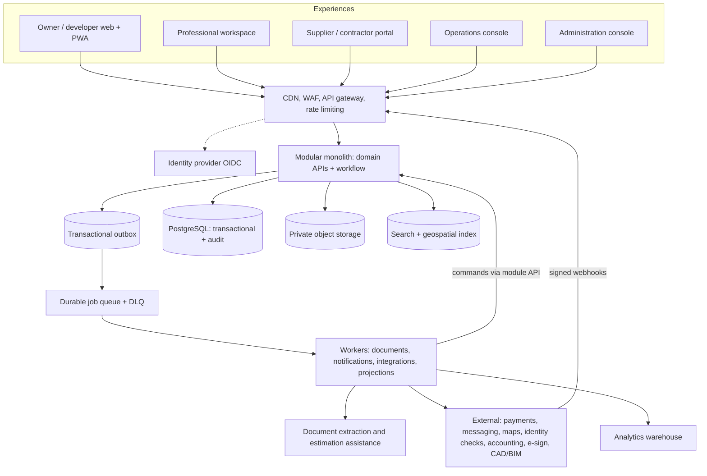
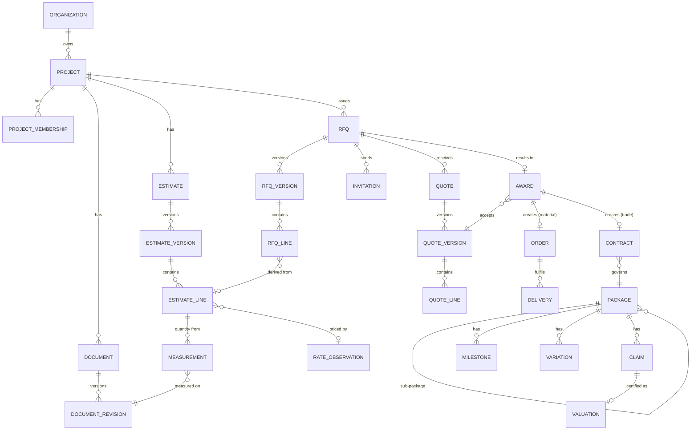

# Construction Planning and Marketplace Platform

## Full-Build Technical Specification — Version 3.0

| | |
|---|---|
| **Audience** | Product, design, engineering, data, construction professionals, marketplace operations, customer support, security and compliance |
| **Status** | Target-state specification, reviewed and gap-filled. Not a country-specific legal implementation. Items marked **[Proposed]** are recommended defaults that need an Architecture Decision Record (ADR) or owner sign-off before they become binding. |
| **Version** | 3.0, 13 November 2026. Supersedes v2.0 (12 November 2026) and the client's Revision 2 PDF (13 November 2026), which it merges. |
| **Companion documents** | [Product strategy](construction-platform-product-strategy.md) · [MVP technical product and design specification](construction-platform-technical-product-design-spec.md) |
| **Precedence** | **This document governs every release.** Revision 2 moved the public marketplace website to Release 1, so the MVP specification now describes **Release 2** (project and professionally reviewed estimate): where it says "Release 1", read "Release 2". The product strategy's phase plan predates website-first sequencing; §25 maps the two. Where companion documents conflict with this one, raise a decision (§29); none silently overrides another. |

### Document conventions

- **MUST / MUST NOT** are release-blocking requirements. **SHOULD** is a strong default; any deviation needs a recorded reason. **MAY** is optional.
- **[Proposed]** marks a recommended value or technology choice that still needs confirmation (§29).
- **[Jurisdiction]** marks a value that comes from the market's jurisdiction pack (§8.7) and is never hard-coded.
- Canonical term definitions are in §4. Where wording differs between companion documents, §4 governs.

### What changed in v3.0

The client's Revision 2 re-sequenced the launch: the platform now **starts as a public construction marketplace website** (a classifieds model, with jiji.ng as the reference) and grows into the controlled project record. Revision 2 was written on top of v1.0, so it dropped every fix that v2.0 had made. This version:

1. **Merges the two:** all of v2.0's structure and fixes, plus Revision 2's website-first plan.
2. Adds **§3, the marketplace website (Release 1)**, reviewed and completed: a full listing state machine with actors and side effects, moderation targets and reason codes, unit-aware price comparison, a promotion purchase lifecycle, phone-verification abuse controls, measured reputation definitions and acceptance criteria.
3. **Renumbers releases R0–R6** to match Revision 2 (the website is R1; v2.0's R1–R5 become R2–R6) and adds a Release 1 exit gate (§25).
4. Threads the website through the rest of the spec: glossary, technology baseline (now Next.js + Fastify), bounded contexts, rate engine (`advertised_listing_price`), API paths, events, notifications, data classification and retention, SLOs, test scenarios, metrics, checklist, decisions D-15…D-23 and ADRs.
5. Corrects the **precedence statement**, which still said the MVP specification governs Release 1.

Appendix C.2 lists every Revision 2 finding and where it is resolved. Appendix D adds the website permission matrix.

### What changed in v2.0 (from v1.0)

v1.0 was a sound capability outline, but it could not be implemented as written. This revision:

1. Adds a **glossary and canonical naming** (§4), resolving the Quote/Bid, Delivery/Shipment and event-name inconsistencies.
2. Adds a **reference technology baseline** (§6) and an **ADR log** (§29).
3. Defines the **tenancy and cross-organization access model** (§7), which v1.0 used without ever specifying.
4. Adds a **logical ERD, money/FX/tax/unit rules** (§8) and **state machines** for every core business object (§9).
5. Adds a **client-specified scope** maturity level so users can request quotes without a reviewed estimate, without that scope being mislabelled (§11.1).
6. Specifies **file formats, limits and the processing pipeline** (§12), **notifications** (§16), **offline sync** (§17), **data classification and retention** (§20), **CI/CD and migrations** (§22).
7. Replaces "define later" with **proposed starting SLOs, RPO/RTO and AI acceptance thresholds** (§11.5, §21), each clearly marked for ratification.
8. Adds **subcontracting** (package hierarchy), **retention money**, **verified-transaction reviews** and **payment-adjacent controls** that v1.0 omitted.
9. Corrects the **permission matrix**: owners can now create draft and indicative estimates, and the ambiguous awarded-provider access is defined (Appendix B).
10. Maps the **release roadmap to MVP phases** with explicit exit gates (§25).

Appendix C lists every review finding and how it was resolved.

---

## 1. Executive implementation brief

The product is a multi-sided construction delivery platform. It connects a building owner or developer with qualified design and cost professionals, suppliers, logistics providers and trade contractors around **one controlled project record**. It supports the lifecycle from project brief and plan review through estimates, tendering, procurement, construction coordination, change control, payment records and handover.

The full build covers five product areas:

1. **Project planning and estimating:** structured brief, document control, assisted takeoff, professional BoQ/estimate review, cost plan and change analysis.
2. **Sourcing marketplace:** catalog, provider profiles, price observations, RFQs, quotes, comparison, award, orders, deliveries, returns and disputes.
3. **Trades and construction delivery:** trade packages and subcontracts, tendering, contracts, schedules, site logs, quality/safety records, progress, valuations, variations and handover.
4. **Professional and platform operations:** qualification checks, estimate review, provider onboarding, support, dispute operations, moderation, reconciliation and audit.
5. **Platform administration and intelligence:** jurisdiction configuration, catalogs, rate sources, permissions, workflow rules, reporting, integration health and model governance.

This specification does **not** choose the launch country, city, measurement standard, tax rules, payment provider, privacy regime or building-control workflow. Each one is a configured **jurisdiction pack** that MUST be approved before the dependent module goes live. Nigeria is a candidate market only and appears here solely as a worked example (§8.8).

### 1.1 Product safety principle

Software MAY classify drawings, index sheets, suggest counts and measurements, draft estimates, identify missing inputs and highlight anomalies. It MUST NOT present a construction-ready bill of quantities, or certify design, structural adequacy, code compliance or safety, without a named qualified reviewer. Human responsibility, source evidence and estimate maturity MUST stay visible on every screen, export and API response that shows a quantity or price.

### 1.2 System shape

A **modular monolith, API-first**, with:
- a transactional core (relational database);
- private document storage;
- durable asynchronous processing using a transactional outbox;
- a separate analytics pipeline;
- documented criteria for extracting a module into its own service later.

Issued estimates, submitted quotes, awards, contracts, invoices and ledger entries are **versioned, immutable and auditable**. Customer, provider, professional, operations and admin experiences are built on shared domain services, with role- and relationship-based permissions.

### 1.3 Launch approach: marketplace website first

The platform launches as a public construction marketplace website: sellers of materials, equipment hire, trades, professional services and logistics post listings; buyers search by category and area and contact sellers by chat, phone or structured quote request. **Release 1 holds no buyer–seller money and arranges no delivery.** It builds the seller supply, buyer demand and local price data that later releases depend on, using the same accounts, categories and records (§3).

---

## 2. Product scope and user groups

### 2.1 User groups

| User group | Jobs to be done | Primary records |
|---|---|---|
| Website visitor / buyer | Find materials, equipment, trades and professionals in an area; compare prices in the same unit; contact sellers safely; save searches | Search, listing, chat thread, quote request, review |
| Website seller (individual or business) | Post and manage listings, answer enquiries, build reputation, buy visibility | Listing, storefront, chat thread, quote request, promotion purchase |
| Owner-builder / homeowner | Define the project, understand cost and scope, select providers, monitor spend and progress, resolve issues, keep records | Project, estimate, RFQ, order, schedule, variation, handover |
| Developer / commercial client | Manage several projects, budgets, approvals, procurement strategy, tender decisions and reporting | Portfolio, cost plan, RFQ packages, contracts, commitments, actuals |
| Architect / design professional | Manage design inputs, issue revisions, answer RFIs, coordinate design intent | Document register, revision, RFI, design decision |
| Quantity surveyor / estimator | Produce and review takeoffs, BoQs, cost plans, tender analysis, valuations, variations and final accounts | Measurement, estimate, rate observation, valuation, final account |
| Engineer / specialist consultant | Provide discipline-specific design, review, inspection and technical decisions | Discipline package, submittal, RFI, inspection |
| General contractor / builder | Bid, plan work, let subcontracts, report progress, request changes, value work | Quote, contract, package/sub-package, schedule, site diary, variation, claim |
| Trade contractor | Price, plan and carry out defined trade scope; submit evidence; report blockers and defects | Package, quote, milestone, inspection, variation |
| Supplier / merchant / manufacturer | Maintain catalog and stock, respond to RFQs, fulfil orders, manage substitutions, invoices and returns | Catalog listing, price observation, quote, order, delivery, invoice, return |
| Logistics provider | Quote transport, schedule loads, track dispatch and delivery, record proof | Delivery, consignment, status event, proof of delivery |
| Platform operations | Verify participants, assist sourcing, investigate reports, manage disputes and support | Verification case, match, case, intervention, audit |
| Platform administrator | Configure markets, terms, catalogs, permissions, integrations and policy thresholds | Jurisdiction pack, policy, feature flag, integration, audit |

One person can hold several roles. For example, a general contractor is a provider to the owner and a client to their subcontractors (§7.4).

### 2.2 Supported project classes

The domain supports residential and commercial work, new build and renovation, multiple floors and phased execution. Each **project class** is an explicit template pack with its own:

- required drawings, specifications and approvals;
- work breakdown and method of measurement;
- specialist disciplines and reviewer qualifications;
- estimate templates, risk allowances and default assumptions;
- compliance checklist and contract templates;
- milestone and inspection requirements.

A project class MUST be enabled per jurisdiction. Complex or high-risk building types (high-rise, industrial, assembly occupancy, structural alteration of occupied buildings) stay **disabled for self-serve estimation** until a qualified professional workflow is configured. The platform can still hold project records for them or make referrals.

**Launch class [Proposed]:** simple low-rise residential new build, one or two storeys. This matches the strategy recommendation.

### 2.3 Capability map

| Capability | Full-build requirement | First release |
|---|---|---|
| Marketplace website | Category-based classified listings, area search, listing detail, post-an-ad, moderation, chat, phone reveal, quote requests, storefronts, reviews, saved searches, paid visibility | R1 |
| Identity and organizations | Individual, business, professional and provider profiles; teams; invitations; access review; identity/organization checks | R2 |
| Project portfolio | Multiple projects, budgets, teams, sites, workstreams, document spaces, reporting | R2 (single project), R6 (portfolio) |
| Brief and feasibility | Guided brief, site constraints, readiness checklist, indicative range | R2 |
| Design and document management | Multi-discipline register, revisions, permissions, comparison, markup, RFI, submittal, approval trail | R2 (register, revisions, RFI), R4 (submittals) |
| Estimation and cost management | Takeoff, BoQ, cost plan, tender analysis, baseline, commitments, actuals, forecasts, final account | R2 (estimate), R4 (cost control) |
| Material sourcing | Catalog, spec normalization, price observations, matching, RFQs, substitutions, orders, delivery, returns | R3 |
| Trade marketplace | Profiles, verification, service areas, RFQ/tender, quotes, comparison, award, contract, performance | R3 |
| Project delivery | Schedule, dependencies, daily logs, progress, inspections, quality, safety, defects, variations, handover | R3 (milestones, variations), R4 (full) |
| Payments and financial records | Invoices, payment schedules, receipts, milestones, fees, refunds, reconciliation, tax exports, *only where lawful and contracted* | R2–R4 record-only; R5 processed |
| Trust and safety | Verification, fraud signals, incidents, disputes, evidence, appeals, moderation, emergency escalation, audit | R2 (core), R3 (full) |
| Analytics | Funnel, estimate variance, procurement performance, project financials, provider performance, reliability | R2 (events), R6 (advanced) |
| Integrations | Payments, messaging, maps, identity, accounting, e-signature, CAD/BIM, registries, data feeds via adapters | R2 (email/SMS), R5–R6 |
| Platform administration | Markets, currencies, units, catalogs, terminology, legal text, policies, roles, pricing, feature flags | R2 |

---

## 3. Launch product: construction marketplace website (Release 1)

### 3.1 Why the platform starts as a marketplace website

The full build depends on three things that cannot be bought at launch: active suppliers, trades and professionals; a steady flow of buyers with real construction needs; and observed local prices. A public, classifieds-style marketplace website builds all three at the lowest operational and legal risk, so it is **Release 1** (§25). Project records, professionally reviewed estimates, structured procurement, delivery controls and payments are added in later releases on the **same accounts, sellers, categories and price data**.

The reference model is the general classifieds site jiji.ng. The following describes how that site operates, from its help pages and published analyses (§30). It informs this design and is not a claim about this platform:

- Posting is free for first-time sellers; sellers pay for premium services that raise visibility and listing capacity (top placement for a period, "Boost" visibility subscriptions, and pay-per-click promoted placement).
- Buyers contact sellers through in-site chat or by phone. Seller profiles show verification status, time on the platform, typical reply time and buyer feedback.
- Moderation teams review ads, and automated systems flag suspicious activity.
- The site does not process the buyer–seller payment or arrange delivery; parties settle and collect directly, guided by safety advice.
- Sign-in uses SMS verification codes, with passkeys and biometrics on supported devices.

This platform adopts that pattern for one vertical and adds what a general classifieds site lacks: construction-specific categories and attributes, **price units buyers can compare** (per bag, per tonne, per trip, per square metre), structured quote requests, trade and professional credentials, and a path from a listing to a project, an estimate and a purchase order.

### 3.2 Release 1 scope

| In Release 1 | Not in Release 1 |
|---|---|
| Public, search-indexed, mobile-first website | Native Android/iOS apps (after the website proves demand, D-22) |
| Construction categories with category-specific attributes and price units | Land, plots and property sales (**excluded**: title-fraud risk, §1.1; D-18) |
| Free listings within configurable per-category allowances | Project workspace, document register, estimates and BoQ (R2) |
| Product, hire, service and professional-profile listing types | Structured RFQs, quote comparison, awards and purchase orders (R3) |
| Browse, search, location and attribute filters, unit-aware sort | Any buyer–seller payment, escrow, split settlement or payouts (R5, D-06) |
| Listing detail with seller card and safety guidance | Platform-arranged delivery or logistics booking |
| Post-an-ad with photo upload, moderation and appeals | Assisted takeoff or any AI estimation |
| In-site chat, phone reveal and structured "Request a quote" | Contracts, variations, valuations and handover (R4) |
| Seller storefronts for individual and business sellers | Pay-per-click placement (after click-fraud controls and traffic are measured) |
| Phone-verified accounts; optional business and credential checks | — |
| Reviews tied to a recorded buyer–seller interaction | — |
| Saved listings, saved searches and alerts | — |
| Paid visibility (top placement, visibility packages) via hosted checkout | — |
| Report-an-ad, moderation queue, restrictions and appeals | — |
| Operations and admin consoles for categories, moderation and promotions | — |

### 3.3 Category taxonomy

Categories are **configuration, not code**. Each `CategoryVersion` defines its attribute schema, permitted price units, required and minimum photos, listing period, auto-publish eligibility, moderation rules, free allowance and promotion prices. Publishing a new category version **never rewrites existing listings**: a live listing keeps the version it was created under until the seller makes an edit, at which point the form migrates it and asks for any newly required attributes. Categories can be retired (no new listings) but not deleted while listings reference them.

Attribute types: `text`, `enum` (with localized labels), `number` with unit, `boolean`, `range`, and `pack_size` (a quantity with a unit, e.g. *50 kg* for a bag of cement), which is what makes per-unit price comparison possible (§3.7).

Launch taxonomy **[Proposed — validate with seed sellers and search data, D-15]**:

| Top-level category | Example subcategories | Listing type | Typical price units | Required attributes (examples) |
|---|---|---|---|---|
| Building materials | Cement, blocks, sand and granite, reinforcement bars, roofing sheets, timber, ceilings | Product | Per bag, per tonne, per trip, per piece, per bundle | Brand/grade, size/gauge, **pack size**, quantity available, minimum order, delivery offered |
| Finishes and fittings | Tiles, paint, doors and windows, sanitary ware, kitchen fittings | Product | Per carton, per m², per litre, per piece | Brand, model, finish/colour, dimensions, condition |
| Plumbing and electrical | Pipes and fittings, tanks, cables, switchgear, lighting, solar components | Product | Per metre, per roll, per piece | Specification/rating, brand, standard marking *as declared by the seller* |
| Tools and equipment | Power tools, hand tools, scaffolding, safety equipment | Product or hire | Per piece; per day/week for hire | Condition (new/used), brand/model, hire deposit and terms |
| Plant and machinery hire | Excavators, concrete mixers, tipper trucks, cranes, generators | Hire | Per hour, per day, per trip | Capacity, operator included, service area, mobilisation charge |
| Trades and services | Masons, tilers, carpenters, electricians, plumbers, welders, painters, ceiling installers | Service | Per day, per m², per job, quote on request | Trade, service area, years of experience, portfolio photos |
| Professionals | Architects, quantity surveyors, engineers, land surveyors, project managers | Professional profile | Per engagement, quote on request | Discipline, registration body and number (**verified separately**), service area |
| Logistics | Haulage, material delivery, equipment transport | Service | Per trip, per km band | Vehicle type and capacity, service area |

### 3.4 Listing types and core fields

| Field group | Product | Hire | Service | Professional profile |
|---|---|---|---|---|
| Identity | Title, category, subcategory | Title, category | Title, trade | Name or practice, discipline |
| Price | Amount, currency, unit, pack size, negotiable flag, minimum order | Rate, unit (hour/day/week/trip), deposit, mobilisation charge | Rate and unit, or "quote on request" | Fee basis, or "quote on request" |
| Description | Free text plus category attributes | Condition, operator included, terms | Scope offered; materials included/excluded | Services, past project types |
| Media | 1–10 photos (minimum set by category) | Photos of the actual item | Portfolio photos | Portfolio images, practice logo |
| Location | Region and area; optional pickup point | Base location and service area | Service area | Service area |
| Availability | Quantity in stock, lead time | Available-from date | Earliest start | Accepting new work |
| Delivery | Delivery offered, delivery areas, charge basis | Transport included or charged | — | — |
| Compliance | Seller-declared standard or grade | Seller-declared inspection/maintenance date | Declared credentials | Registration details |

- Every price stores the amount in minor units, currency, a unit from the unit catalog (§8.5) and **the date the seller last confirmed it**. That confirmation date drives freshness labels, ranking and the rate engine (§11.3).
- Seller-declared facts (grades, standards, registrations, credentials) are always shown as **"declared by seller"** until a verification check (§13.2) confirms them. A professional listing MUST NOT display a registration as verified unless the professional-credential check has passed against the issuing body.
- Every edit creates a `ListingVersion`. Buyers' saved copies, chats and quote requests reference the version they saw.

### 3.5 Locations and service areas

- Locations use the two-level administrative hierarchy in the jurisdiction pack (for example state → city/area). Each area has a **centroid and, where available, a boundary polygon** in the pack, so distance can be used in ranking without precise user location.
- Exact addresses are private by default; listing pages show the area only. A business seller MAY publish a business address on its storefront.
- Service, hire and logistics listings use **service areas** (a list of areas or a polygon). Search matches the buyer's chosen area against the service area, not the seller's home address.
- Search defaults to the visitor's last chosen area. Location MUST NOT be inferred from IP for anything other than a default suggestion the visitor can change, and precise device location is used only with explicit permission for a single search.

### 3.6 Website information architecture and page types

| Page | Purpose | Key content and actions |
|---|---|---|
| Home | Entry and discovery | Search bar with area selector, top-level categories, recently viewed, promoted listings (labelled), "Post an ad" |
| Category page | Browse one category in an area | Subcategory chips, filters, sort, results, result count, SEO text |
| Search results | Keyword plus filters | As category page; spelling tolerance; "Save this search" |
| Listing detail | Decide to contact | Gallery, price and unit (with per-unit price where comparable), attributes, description, area, seller card, Chat, Show phone number, Request a quote, Save, Share, Report, safety tips, similar listings |
| Seller storefront | Trust and catalogue | Name, completed verification checks with dates, time on platform, measured reply rate and time, rating and reviews, live listings, business hours, service areas |
| Post an ad | Create or edit a listing | Category picker, attribute form, photo upload, price and unit, location, contact preferences, preview, submit; saved as an offline draft when the connection drops |
| My ads | Manage listings | Status (draft, in review, live, rejected with reason, expired, closed, blocked), edit, renew, close, reopen, promote, appeal, statistics (views, contacts) |
| Messages | Chat inbox | Threads grouped by listing, quote requests, safety banners, block and report |
| Saved | Favourites and saved searches | Saved listings; saved searches with alert frequency |
| Account | Profile and security | Phone and email, passkeys, active sessions and sign-out-everywhere, notification preferences, data export and deletion |
| Promote | Buy visibility | Eligible listings, packages, price incl. tax, duration, terms, purchase history and invoices |
| Help and safety | Guidance | Buyer and seller safety tips, posting rules, prohibited items, fees, contact support |

**URL scheme:** human-readable, stable and indexable, e.g. `/{area}/{category}`, `/{area}/{category}/{subcategory}`, `/listing/{slug}-{id}`, `/seller/{handle}`. Filters that would create thin or duplicate pages use query parameters with a canonical tag to the unfiltered page. Only curated area–category combinations with real inventory (≥ 5 live listings **[Proposed]**) go into sitemaps. Slugs change with titles; old slugs `301` to the current one, keyed by `{id}`.

### 3.7 Search, browse and ranking

- **Filters:** category, area, price range, unit, condition, brand, delivery offered, seller type (individual/business), verification checks present, listing age; plus category-specific filters from the category version.
- **Sort:** relevance (default), newest, lowest price, highest price.
- **Unit-aware price comparison:** price sorting only ranks listings that share a **comparable unit**. Where a listing declares a pack size (e.g. a 50 kg bag), its price is also normalized to the category's base unit (per kg), using the item-specific conversion rules in §8.5; listings without a convertible pack size are **grouped by unit, never ranked against other units**. The UI says which unit is being compared.
- **Relevance inputs:** text and attribute match, distance from the selected area's centroid, listing freshness and last price confirmation, listing completeness, the seller's measured reply rate and completed verification checks. Every input is logged so ranking can be explained (§13.1).
- **Promoted listings** occupy labelled slots ("Promoted" or "Top") and are never interleaved unlabelled with organic results. Promotion changes position **only among eligible listings**; it never makes an ineligible, expired, restricted, non-live or out-of-area listing visible. Slot limits per results page **[Proposed]**: up to 3 top-placement slots above organic results and 1 promoted slot per 10 organic results; when more listings qualify than slots, they rotate with equal share per purchase tier. Empty promoted slots collapse; they are never filled with unlabelled content.
- **Engine:** PostgreSQL full-text search with trigram similarity and indexed filters, with locale-specific dictionaries and a configurable synonym list per pack (e.g. brand and local trade names). Move to a dedicated search index only on measured latency or relevance problems (§5.4, D-21).

### 3.8 Listing lifecycle and automated checks

The state machine is owned by the listings module. A listing is publicly visible **only in `live`**.

| From | Command | To | Actor | Notes |
|---|---|---|---|---|
| `draft` | `submit` | `in_review` or `live` | Seller | `live` only if every automated check passes **and** the category allows auto-publish; otherwise `in_review`. Blocked from submitting if the free allowance is used up (§3.13) |
| `in_review` | `approve` | `live` | Moderator | Reason code recorded |
| `in_review` | `reject` | `rejected` | Moderator | Reason code plus a plain fix message to the seller |
| `rejected` | `resubmit` | `in_review` | Seller | After editing |
| `live` | `material_edit` | `in_review` | Seller | Material = category, title, photos, or a price change beyond the category threshold (default ±20% **[Proposed]**). Minor edits publish immediately as a new version |
| `live` | `flag` | `in_review` | System | Reports reach the category threshold, or a new risk signal fires |
| `live` | `expire` | `expired` | System | Listing period ends (per category) |
| `expired` | `renew` | `in_review` or `live` | Seller | Seller reconfirms price and availability; refreshes the price-confirmation date; re-runs checks |
| `live` / `expired` | `close` | `closed` | Seller | Reason: sold, no longer available, other |
| `closed` | `reopen` | `in_review` or `live` | Seller | Within the listing period; re-runs checks |
| any non-final | `block` | `blocked` | Moderator | Policy breach. Final apart from appeal |
| `rejected` / `blocked` | `appeal` → `uphold` / `overturn` | unchanged / `in_review` | Seller → a **different** moderator | One appeal per decision |

**Effects of leaving `live`:** promotions pause (§3.13); open chats stay readable with a "listing no longer available" banner; pending quote requests are marked `listing_unavailable`; the public page shows "no longer available" with similar listings (§3.16).

**Automated checks at submission and material edit:**
1. Required attributes and minimum photos for the category version.
2. Prohibited words, phone numbers, email addresses, links and payment instructions in title or description (contact goes through chat or phone reveal).
3. Duplicate or reused photos by perceptual hash, including photos already used by **another** seller (the matching listing is shown to the moderator).
4. Price far outside the observed range for the same category, unit and region. **Cold start:** the check uses observed listing prices once ≥ 20 confirmed observations exist for that category/unit/region **[Proposed]**; before that, it uses reference ranges from the jurisdiction pack if configured, otherwise it is skipped and the listing is sampled for human review.
5. Account signals: new account, posting velocity, prior rejections, open reports, restrictions.
6. Prohibited and restricted items for the pack (§3.15).

Each check contributes to a **risk score** that orders the moderation queue; the score and its contributing signals are stored with the listing version.

### 3.9 Moderation

- **Queue** ordered by risk score, then age. Moderators see the listing version, the signals that triggered review, the seller's history, prior decisions and any matching listings.
- **Decisions** record a reason code from a versioned catalog (e.g. `missing_required_photos`, `contact_details_in_text`, `reused_photos`, `price_outlier_unverified`, `prohibited_item`, `misleading_claim`, `wrong_category`), the moderator and time. Rejections show the seller a plain reason and how to fix it.
- **Targets [Proposed, ratify per D-17]:** first decision within 4 business hours at P90; reports actioned within 24 h; impersonation reports within 4 business hours with priority review.
- **Appeals:** one per decision, reviewed by a different moderator; the outcome is final and explained.
- **Quality:** 5% of decisions **[Proposed]** are re-reviewed weekly; disagreement rates feed moderator training and rule tuning.
- **Restrictions** (`SellerRestriction`): posting limit, chat limit, listing suspension and account suspension, each with reason, duration, reviewer and appeal path. Blocking a verified business, or any restriction triggered by an impersonation report, needs a second moderator **[Proposed]**.
- Every moderation and restriction action writes an audit event (§20.4).

### 3.10 Buyer–seller contact

- **Chat** requires a signed-in, phone-verified account. Messages are stored per listing thread between two accounts. Attachments are images only and go through the photo pipeline (§3.16). Links, payment instructions and requests to move off-platform trigger an in-thread safety banner; known scam phrases and links are blocked or held for review. Either party can block or report the other. Staff can read a thread **only** through a report or case, and the access is audited (§7.6).
- **Show phone number** is available to signed-in users only, rate-limited per user, per device and per listing (defaults: 20 reveals per user per day, 3 per device per hour **[Proposed]**), and logged as a `ContactReveal` (used for seller statistics and scraping detection). Sellers can choose **chat-only**.
- **Request a quote** is a structured message: quantity and unit, delivery area, required date and notes. It is stored as a `QuoteRequest` linked to the listing version and both accounts, with states `sent → viewed → answered | declined | expired | listing_unavailable` (expiry 14 days **[Proposed]**). In R1 the seller answers with a price in chat; from R3 the same record seeds an RFQ invitation (§3.17). *Not to be confused with an RFQ or a Quote (§4).*
- **No payment through the site in R1.** Every listing and chat shows the standing guidance: inspect before paying; prefer meeting at the seller's business premises or the delivery site; never pay "booking" or "release" fees; never share sign-in codes.

### 3.11 Accounts, authentication and seller identity

- **Accounts:** one `User` per person, which later becomes a project owner or team member (§3.17). Individual sellers act through their personal organization; **business sellers** are an `Organization` of kind `business` with team roles mapped to org roles (§7.2): owner → `owner`, manager → `admin`, staff → `member`.
- **Phone verification:** a one-time SMS code is required to post, chat or reveal phone numbers; browsing needs no account. One active account per phone number. Controls against **SMS-pumping fraud**: per-number, per-IP and per-device limits, a destination country allowlist from the pack, and bot defence before sending. Fallback channel (voice OTP) **[Proposed, D-19]**. Email is optional for individuals and required for business sellers (for invoices).
- **Recycled numbers:** if a phone number is re-verified by a new person, the old account is not handed over; the new person gets a new account, and the old account owner must recover through their other factors (passkey, email) or support.
- **Sign-in and session security:** SMS code on new devices, passkeys supported, active-session list, sign-out-everywhere, and alerts on phone, email or passkey changes.
- **Storefront:** every seller has a public page (§3.6). Verified businesses can reserve their trading name; similar names are flagged at submission.
- **Verification checks** use the per-check model in §13.2 (identity, business registration, professional credential, trade reference, product/stock evidence). The storefront shows exactly which checks are complete and their dates.
- **Account deletion:** listings close, chats are anonymized for the other party ("deleted user") but kept for the retention period (§20.3), reviews written by the user are removed, reviews about a business stay with the business.

### 3.12 Reviews and reputation

- A buyer can review a seller only after a **recorded interaction**: a chat thread with replies from both sides; a quote request the seller answered; or a contact reveal followed by the buyer confirming, when prompted 3 days later **[Proposed]**, that they dealt with the seller.
- One review per buyer per seller per 90 days; rating 1–5 plus text; the seller can reply once, publicly. Reviews pass moderation for abuse, personal data and conflicts of interest (same device, same organization, linked accounts).
- **Measured reputation only** (no composite "trust score" in R1): reply rate (threads with a seller reply within 24 h ÷ threads started, last 90 days), median first-reply time (last 90 days), account age, review count and average, and completed verification checks. Reply metrics show only when ≥ 5 threads exist in the window **[Proposed]**; otherwise "not enough data yet".
- These records become provider performance history in R3 (§13.4).

### 3.13 Monetization in Release 1

All commercial rules are `FeeRule`/`PromotionProduct` configuration (§13.5); the values below are mechanisms, not price points (D-16).

| Mechanism | How it works | Configuration |
|---|---|---|
| Free listing allowance | Live listings each seller may keep free per category | Allowance per category and seller type. When used up, new submissions stay in draft with options to close another listing or buy a package |
| Top placement | One listing shown in labelled top slots of its category and area for a fixed period | Durations (e.g. 7 or 30 days), price per category and area |
| Visibility package | Subscription that raises the listing allowance and the share of promoted slots | Tiers, duration (monthly to annual), allowance, slot share, price |
| Verified business display | Business verification shown on the storefront | Fee only if the check itself has a cost, by jurisdiction |
| Pay-per-click placement | Promoted placement charged per click on a daily budget | **Deferred** until click-fraud controls and traffic are measured |
| Display advertising | Labelled slots for brands and manufacturers | Optional; never inside chat or safety content |

- **Promotion purchases are the only payments in R1.** They are the platform's own services, bought by the seller through a payment provider's **hosted checkout** (no card data touches the platform). Each purchase is recorded with an invoice and tax treatment from the pack, as a `PlatformFee` entry in a minimal revenue ledger that migrates into the R5 ledger (§14). They are entirely separate from any buyer–seller transaction.
- **Purchase lifecycle:** `pending_payment → paid → active → expired`, plus `cancelled` and `refunded`. Activation happens only on the provider's signed webhook (§15.6), never on the browser redirect.
- **When a promoted listing leaves `live`**, the promotion **pauses** and the remaining time resumes if it returns. If it is rejected or blocked, unused time becomes a credit for another listing, except where the block is for fraud or a prohibited item, where it is forfeited under the published terms **[Proposed]**. Expiry ends a promotion automatically with no manual step.
- A purchased promotion never changes a moderation or verification outcome, and paying sellers get no moderation priority.

### 3.14 Safety and fraud controls

| Threat | Controls |
|---|---|
| Advance-fee and fake-stock scams | Price-outlier flag, reused-photo detection, new-account limits, payment-instruction blocking in listings and chat, standing safety guidance |
| Impersonation of real suppliers or professionals | Business and credential checks; reserved names; report-impersonation route with priority review |
| Counterfeit or substandard materials | Grades shown as declared; "counterfeit/substandard" report reason; repeat reports restrict the seller and open a trust case (§13.3) |
| Scraping of listings and phone numbers | Reveal only when signed in; rate limits; bot defence; reveal logging; anomaly alerts |
| Fake reviews | Interaction-gated reviews; linked-account detection; moderation |
| Account takeover | SMS code on new devices; passkeys; session list and sign-out-everywhere; change alerts |
| SMS-pumping (toll fraud) | Per-number/IP/device limits; country allowlist; bot defence before OTP send; spend alerts |
| Lead harvesting with fake listings | Duplicate and reused-photo checks; new-account velocity limits; reply-without-stock reports |
| Unsafe trade work arranged through the site | Safety guidance on trade listings; "unsafe work" report routed per §13.3; the platform does not certify workmanship |
| Prohibited items | Category rules and the pack's prohibited/restricted list, enforced at submission and by reports |

### 3.15 Prohibited and restricted items

The jurisdiction pack holds the prohibited and restricted lists. Baseline: **land, plots and property** are excluded (D-18). Restricted items (e.g. explosives used in quarrying, hazardous materials such as asbestos-containing products, second-hand safety-critical equipment without inspection records) are either prohibited or require extra attributes and human review, as the pack defines.

### 3.16 Website technical requirements

- **Rendering:** server-side rendering, or static generation with incremental revalidation, for home, category, search, listing and storefront pages, so content is indexable and fast on first load. Interactive parts (chat, posting, filters) hydrate on the client. Pages that show personal or session data are never cached at the edge.
- **SEO:** stable URLs, canonical tags, XML sitemaps per curated area–category, `robots` rules for filter permutations, and structured data (schema.org `Product`/`Offer` for products, `Service` and `LocalBusiness` for trades and storefronts). An expired or closed listing keeps its URL with "no longer available" and similar listings, then returns `410` after 90 days **[Proposed]**.
- **Performance targets [Proposed — confirm with field data]:** Core Web Vitals "good" at P75 on a mid-range Android over mobile networks: LCP ≤ 2.5 s, INP ≤ 200 ms, CLS ≤ 0.1.
- **Low bandwidth:** responsive images in modern formats with server-side resizing; lazy loading below the fold; a lightweight listing card; a **data-saver mode** that loads photos on tap; an installable PWA shell with **offline drafts** for the post-an-ad form (§17).
- **Image pipeline:** direct upload to private object storage with signed URLs; asynchronous jobs strip location and device metadata, generate sizes, compute perceptual hashes and run content checks (prohibited imagery, visible personal data such as phone numbers or faces of third parties) before photos become public through the CDN. Rejected photos never become public.
- **Alt text:** sellers are prompted for alt text; a generated suggestion MAY be offered but is shown to the seller to confirm before publishing. Decorative images are marked as such.
- **Notifications:** SMS for security codes; email and SMS for moderation outcomes; web push and email for chat messages and saved-search alerts (instant or daily digest, chosen by the user); other channels only through consented official business APIs (§16).
- **Accessibility:** WCAG 2.2 AA (§18.5); filters, gallery and chat are keyboard and screen-reader operable.
- **Analytics and consent:** privacy-respecting event tracking for search, listing view, contact actions, posting funnel and promotion purchases (§23). Non-essential cookies and trackers load only after consent where the pack requires it.

### 3.17 How the website grows into the full platform

| Release 1 object | Becomes or feeds |
|---|---|
| Buyer account | Project owner, portfolio and team member (R2) |
| Seller account and storefront | Provider profile with service areas and verification history (R3) |
| Product and hire listings | Catalog listing and inventory observation for sourcing (R3) |
| Listing price with unit and confirmation date | Rate observation of source class `advertised_listing_price` (§11.3), ranked below supplier-confirmed quotes |
| Quote request | Seed of an RFQ invitation and quote (R3) |
| Service and professional listings | Trade and professional matching for tenders and estimate review (R2–R3) |
| Chat thread | Conversation linked to a project, RFQ or order |
| Reviews and reply metrics | Provider performance records (R3) |
| Reports and moderation decisions | Trust and safety cases and provider sanctions (§13.3) |
| Promotion purchases | Platform-fee records in the payments ledger (R5) |

### 3.18 Release 1 acceptance criteria

1. A visitor can find a listing by category, area and keyword, filter and sort by price within a comparable unit, and open the listing without signing in.
2. A seller can verify a phone number, post a listing with category attributes and photos, see its moderation status, and receive a plain rejection reason they can act on.
3. Listings with phone numbers, links or payment instructions in text are blocked or held; reused photos are flagged to moderators with the matching listing shown.
4. A signed-in buyer can chat, reveal a phone number within rate limits and send a structured quote request; the seller is notified within the notification targets (§21.1).
5. Promoted listings are always labelled, never appear outside their eligible category and area, pause when the listing leaves `live`, and stop on expiry without manual action.
6. Storefronts show only measured reputation values and only completed verification checks.
7. A buyer without a recorded interaction cannot review a seller and is told why.
8. Category, search and listing pages meet the performance targets on the reference device profile and pass the accessibility checks.
9. Operations can action a report, restrict a seller and process an appeal, with each step in the audit log.
10. A promotion purchase is activated only by a verified payment webhook, is invoiced with the pack's tax treatment, and a duplicate webhook does not double-activate it.

---

## 4. Glossary and canonical terms

Code, APIs, events and UI copy MUST use these terms consistently. UI MAY localize the display label, but the domain name stays fixed.

| Term (domain name) | Definition | Notes / not to be confused with |
|---|---|---|
| **BoQ** | Bill of quantities: itemized, measured scope prepared to a method of measurement for defined document revisions | Not a material shopping list |
| **Method of measurement (MoM)** | Professional standard governing how work is measured (e.g., BESMM4 in Nigeria, NRM2 in the UK) | **[Jurisdiction]** plugin |
| **Takeoff** | Set of measurements derived from drawings | `Takeoff` contains `Measurement`s |
| **Estimate** | A priced scope at a declared maturity level; versioned as `EstimateVersion` | Not a quote |
| **Maturity level** | One of the levels in §11.1 that controls permitted use | Shown on every estimate surface |
| **Cost plan** | Budget broken down by work breakdown structure, used for cost control | Built from an accepted estimate |
| **RFQ** | Request for quotation; one domain object covering material, trade and service requests. `rfq_type` ∈ {`material`, `trade`, `service`, `logistics`} | UI MAY say "tender" for trade RFQs |
| **Quote** | A provider's priced response to an RFQ, versioned as `QuoteVersion`, with `QuoteLine`s | v1.0 "Bid" is renamed **Quote** everywhere. UI MAY say "bid" for trade tenders |
| **Award** | Client's binding selection of a specific `QuoteVersion` | Produces an `Order` (material/logistics) or a `Contract` (trade/service) |
| **Order** | Purchase order for goods/logistics, with `OrderLine`s | |
| **Contract** | Versioned agreement for a trade/service **Package** | |
| **Package** | A defined scope of work let to one provider; MAY have child sub-packages (subcontracts) | v1.0 "TradePackage" / "ContractPackage" → **Package** |
| **Delivery** | A planned or actual movement of goods against an order, which can be split across several consignments | v1.0 "Shipment" → **Delivery**. A `Consignment` is one vehicle load |
| **Proof of delivery (POD)** | Evidence of receipt: recipient, time, photo, quantities, condition | Receipt ≠ quality acceptance |
| **Variation** | An approved or proposed change to contracted scope, cost or time | Sometimes called a "change order" |
| **Claim / payment application** | A provider's request for payment against contract lines or milestones | Becomes a **Valuation** once certified |
| **Valuation** | A reviewer-certified value of work done | Not an invoice or a payment |
| **Retention** | Percentage withheld from payments until completion or the defects period ends, where the contract provides | **[Jurisdiction]** + contract |
| **RFI** | Request for information about design or scope | |
| **Submittal** | Product data, sample, shop drawing or method statement submitted for review | |
| **Rate observation** | A dated, sourced price point for a specified item, location and unit | |
| **Jurisdiction pack** | Versioned market configuration (§8.7) | |
| **Verification check** | A single, dated, sourced provider check (§13.2) | Never one combined "verified" boolean |
| **Case** | A support, dispute, safety, fraud or privacy matter handled by operations | `case_type` discriminator |
| **Listing** | A seller's public advertisement on the marketplace website (product, hire, service or professional profile), versioned as `ListingVersion` | Not a `CatalogListing` until R3 conversion (§3.17) |
| **Category version** | Versioned configuration of a website category: attributes, price units, photo rules, listing period, allowance, promotion prices | Listings keep the version they were created under (§3.3) |
| **Storefront** | A seller's public page with measured reputation and completed checks | |
| **Quote request** | A buyer's structured enquiry on a listing (quantity, unit, area, date) | **Not** an RFQ or a Quote; it seeds an RFQ invitation from R3 |
| **Contact reveal** | A logged, rate-limited display of a seller's phone number to a signed-in buyer | Feeds scraping detection and reputation |
| **Promotion** | Paid visibility for a listing (top placement or visibility package), bought by a seller from the platform | Changes position among eligible listings only |
| **Moderation decision** | A recorded approve/reject/block with reason code, moderator and time | Appealable once |
| **Advertised listing price** | A listing's price with unit and last seller-confirmation date, used as a low-precedence rate observation | §11.3 |
| **Tenant** | An `Organization`; personal accounts get an implicit single-member organization | §7 |

---

## 5. Architecture principles and system context

### 5.1 Principles

1. **Domain ownership:** each module owns its rules, tables and published contracts. No module writes to another module's tables. Cross-module reads go through a module API or read model.
2. **Immutable business snapshots:** issued estimates, submitted quotes, awards, orders, contracts, invoices and accepted terms are immutable. A change creates a new version and an event.
3. **Traceable numbers:** every quantity, rate, tax, fee, FX conversion and total records its source, date, unit/currency and calculation version.
4. **Human accountability:** consequential professional approvals record the human reviewer, their role and qualification reference, the scope and the time.
5. **Configurable jurisdiction:** market rules live in versioned jurisdiction packs and policy services, never in conditionals in the code.
6. **Resilient async processing:** documents, notifications, payment events, analytics and integrations use durable jobs with retries, idempotency and dead-letter queues.
7. **Least privilege and privacy:** data is shared only to the extent the role and the active relationship require (§7).
8. **Graceful degradation:** an outage in payments, maps, OCR or messaging MUST NOT corrupt or block core project records.
9. **Interoperability:** documented exports and stable APIs, so drawings, estimates and financial records are never locked in.
10. **Measured automation:** AI is evaluated against reviewed ground truth, gated by thresholds (§11.5), and can be switched off per market, project class, document type or user.

### 5.2 Logical system context



Workers write back **only through module APIs**, so domain rules apply in one place. External webhooks enter through the edge and are verified there (§15.6).

### 5.3 Deployment topology

- **Edge:** CDN for static assets, WAF, bot and rate protection, TLS termination, API gateway.
- **Identity:** a standards-based OIDC/OAuth 2.1 provider; MFA for staff and admins; step-up authentication for sensitive actions; session revocation.
- **Application:** stateless API instances, separate worker pools per queue class (documents, notifications, integrations, projections), and a scheduler.
- **Data:** managed PostgreSQL with point-in-time recovery; object storage with encryption, versioning and lifecycle rules; search index; cache used only for derived, rebuildable data.
- **Async:** transactional outbox → durable queue with dead-letter queues and replay tooling.
- **Analytics:** outbox/CDC feed into the warehouse. The warehouse is never the source of truth for project state.
- **Environments:** local, shared dev, staging, production. Production has its own credentials and data. Non-production uses synthetic data only (§22.1).
- **Regionality:** hosting region and data residency follow the jurisdiction pack. Use portable patterns (managed Postgres, S3-compatible storage, containers) to avoid lock-in.

### 5.4 Service extraction criteria

Move a module out of the monolith only when at least one of these is shown: a different scaling profile, a different deployment cadence, failure isolation, a regulatory or data boundary, or independent team ownership. Likely candidates, in rough order: document processing, notifications, AI inference, search/matching, payments ledger, analytics ingestion. Every extraction needs an ADR with measured evidence.

---

## 6. Reference technology baseline [Proposed]

Each choice below is a recommendation that can be replaced, not a mandate. What the architecture actually requires is the right-hand column. Record the final choices as ADRs (§29).

| Layer | Recommended baseline | Non-negotiable requirement it satisfies |
|---|---|---|
| Language/runtime | TypeScript on Node.js LTS for API and web; Python workers for document/ML processing | Shared types across web/API; mature PDF/OCR/ML libraries for workers |
| API framework | **Fastify** (TypeScript) modular monolith, one module per bounded context, with an automated check that forbids cross-module imports outside each module's public API **[Chosen for the build, ADR-002]** | Enforced module ownership (§5.1-1) |
| API contract | OpenAPI 3.1 (pin minor), generated typed clients | Published, versioned contract (§15.1) |
| Web | **Next.js** (React) with server rendering and incremental static regeneration for public website pages; the same app hosts signed-in surfaces; installable PWA for field use and offline drafts **[Chosen for the build, ADR-013]** | Indexable, fast first load (§3.16); mobile-first, low-bandwidth, offline drafts (§17) |
| Native mobile | Deferred. React Native only after field research shows need (camera, background sync, offline maps) | §18.1 |
| Drawing canvas | PDF.js rendering + vector overlay layer; server-side rasterization via pdfium in sandboxed workers | Calibrated takeoff, accessible alternative (§11.2, §18.5) |
| Database | PostgreSQL 16+ with PostGIS; row-level security as a second layer of defence | Transactions, geo search, tenant isolation (§7.5) |
| Queue | Postgres-backed job queue at launch (same transaction as outbox); move to a managed broker when throughput or isolation calls for it | Durable, idempotent, replayable (§5.1-6) |
| Object storage | S3-compatible, SSE with KMS keys, versioning, object lock for evidence buckets | Private, tamper-evident evidence (§12) |
| Search | PostgreSQL full-text + `pg_trgm` similarity + PostGIS at launch, with per-pack dictionaries and synonyms; dedicated search engine only on measured latency or relevance problems (D-21) | §3.7, §8.1 Search context |
| Images and CDN | Direct-to-storage signed uploads; worker pipeline for metadata stripping, resizing to modern formats and perceptual hashing; public sizes served through a CDN | §3.16 image pipeline |
| SMS and OTP | SMS provider behind an adapter with voice-OTP fallback, per-number/IP/device limits and spend alerts (D-19) | §3.11 phone verification |
| Identity | Managed or self-hosted OIDC provider supporting MFA, WebAuthn and phone OTP | §19.1 |
| Observability | OpenTelemetry traces/metrics/logs; central log store with PII redaction | §21.4 |
| Infrastructure | Containers on a managed orchestrator or PaaS; infrastructure as code; secrets in a managed vault | §22 |
| Analytics | Managed columnar warehouse + dbt-style transformation; product analytics using pseudonymous IDs | §23 |

**Hosting region selection:** pick the region after the privacy review of cross-border transfer rules (for Nigeria, the NDPA; §8.8). If no compliant in-region option exists, document the transfer mechanism before any production data is stored.

---

## 7. Tenancy, identity and access model

v1.0 called for "tenant isolation" but never said what a tenant is. In construction, one project spans several organizations, so the access model is relationship-based.

### 7.1 Tenancy

- **Tenant = `Organization`.** Every user belongs to at least one organization. Individuals get an implicit personal organization.
- **A project has exactly one owning organization** (the client). The owner controls membership and sharing.
- **Provider organizations never become members of the client's tenant.** They get **scoped `AccessGrant`s** on a project through an invitation, award or contract.
- **Platform staff** belong to a platform organization. Their access to customer data goes through **reason-coded, time-boxed, audited access** (§7.6), never through standing membership.
- **Marketplace website (R1):** buyers and individual sellers act through their personal organization; business sellers are an `Organization` of kind `business`. Live listings, storefronts and reviews are public data (§20.1); chats, quote requests and contact-reveal logs belong to the two parties and are never tenant-shared.

### 7.2 Access primitives

| Primitive | Purpose |
|---|---|
| `OrganizationMember` + org role (`owner`, `admin`, `member`, `billing`) | Who can act for an organization |
| `ProjectMembership` + project role (`owner`, `manager`, `collaborator`, `viewer`, `reviewer`) | Client-side and professional access to a project |
| `AccessGrant(subject_org, project, scope, resource_filter, granted_by, reason, expires_at)` | Scoped access for providers and external parties |
| Scope values | `rfq:{id}:read`, `package:{id}:participate`, `order:{id}:fulfil`, `documents:{set}:read`, `site:address:read`, `site:access:read` |
| `DocumentAccessPolicy` | Per-document restriction layered over project access |

### 7.3 Relationship-driven grants

| Event | Grant created | Grant revoked/narrowed |
|---|---|---|
| Provider invited to RFQ | `rfq:{id}:read` + the RFQ's document set; coarse location only | RFQ closed and quote not awarded → read-only on own quote for the retention period |
| Award (material) | `order:{id}:fulfil` + `site:address:read` + delivery contact | Order closed → read-only history |
| Award (trade) | `package:{id}:participate` + package documents + `site:address:read` + `site:access:read` | Contract closed or terminated → read-only history |
| Reviewer assigned | `reviewer` membership on the project, limited to estimate scope | Assignment completed → read-only on issued versions |

### 7.4 Subcontracting

A `Package` MAY have child packages. When the awarded contractor lets a sub-package, they act as **client** for that sub-package's RFQ and contract. The subcontractor can only see what the main contractor is allowed to share: it inherits a **subset** of the parent grant and never more. The project owner sees sub-package existence, status and safety-relevant records by default. Commercial values of sub-packages stay hidden unless the main contract requires disclosure **[Jurisdiction/contract]**.

### 7.5 Enforcement

- Every API handler calls a central **policy decision point** (`can(actor, action, resource)`) before reading or writing. A hidden UI control is not authorization.
- PostgreSQL **row-level security** enforces `project_id`/`org_id` filtering as a second layer. The application connects with a role that cannot bypass RLS.
- Object storage is reached only through short-lived signed URLs, issued after a policy check (default TTL 5 minutes **[Proposed]**).
- Unauthorized and non-existent resources both return `404` (§15.3), so callers cannot probe for private projects.

### 7.6 Staff access

- Staff roles: `support`, `ops_verification`, `ops_cases`, `finance`, `qs_reviewer` (staff reviewer), `admin`, `security`.
- Access to restricted data (identity documents, exact address, private drawings, payment details) needs a **reason code, case or ticket reference, and time box** (default 4 h **[Proposed]**). It creates an audit event and MAY notify the data owner, depending on the jurisdiction.
- **Dual control** for: payouts and refunds above a threshold, provider suspension or removal, jurisdiction pack publication, and role elevation to `admin`.

---

## 8. Domain model and data ownership

### 8.1 Bounded contexts

| Context | Owns | Publishes (examples) |
|---|---|---|
| Identity and organization | User, Organization, membership, role, credential reference, consent, access grant | `UserRegistered`, `MembershipChanged`, `AccessGrantChanged` |
| Project and design | Project, site, brief, project membership, document, revision, RFI, submittal, design decision | `ProjectCreated`, `DocumentRevisionIssued`, `RfiAnswered` |
| Estimation and cost | Takeoff, measurement, WBS, estimate version, review, cost plan, baseline, commitment, actual, forecast | `EstimateIssued`, `BudgetBaselineChanged`, `ForecastUpdated` |
| Listings and discovery | Category version, listing, listing version, photo, location, service area, saved search, favourite, contact reveal, quote request, seller review, report, moderation decision, promotion, seller restriction | `ListingPublished`, `ListingExpired`, `QuoteRequested`, `ListingReported`, `PromotionActivated` |
| Catalog and pricing | Catalog item, specification, unit, conversion, rate observation, FX observation, assembly | `RateObserved`, `RateExpired` |
| Marketplace and sourcing | Provider profile, service area, RFQ, invitation, quote version, clarification, comparison, award | `RfqPublished`, `QuoteSubmitted`, `AwardMade` |
| Procurement and logistics | Order, delivery, consignment, POD, return, supplier invoice match | `OrderPlaced`, `DeliveryDispatched`, `DeliveryReceived`, `DiscrepancyRaised` |
| Project execution | Package, contract version, schedule, activity, daily log, inspection, safety observation, defect, variation, claim, valuation, handover | `MilestoneChanged`, `InspectionRecorded`, `VariationApproved`, `HandoverAccepted` |
| Payments and ledger | Invoice, payment intent, transaction, refund, payout, ledger, reconciliation, platform fee | `PaymentStateChanged`, `RefundIssued`, `PayoutReconciled` |
| Trust and cases | Verification case and checks, case (support/dispute/safety/fraud/privacy), sanction, appeal, review/rating | `VerificationCheckChanged`, `ProviderSuspended`, `CaseResolved` |
| Communications | Conversation, message, attachment, notification, preference, delivery receipt | `MessageSent`, `NotificationDeliveryFailed` |
| Search and matching | Derived provider/catalog indexes, eligibility evaluation, ranking explanation | `MatchProduced` (internal) |
| Jurisdiction and configuration | Jurisdiction pack, policy, feature flag, legal text, fee rule | `JurisdictionPackPublished`, `FeatureFlagChanged` |
| Audit | Append-only audit log (cross-cutting sink; owned by platform security) | — |

### 8.2 Principal entities

**Identity:** `User`, `Organization`, `OrganizationMember`, `ProfessionalCredential`, `ConsentRecord`, `AccessGrant`, `StaffAccessSession`.

**Project/design:** `Portfolio`, `Project`, `Site`, `ProjectBrief`, `ProjectStage`, `ProjectMembership`, `Document`, `DocumentRevision`, `DrawingSheet`, `Markup`, `Rfi`, `Submittal`, `DesignDecision`, `PermitRecord`.

**Cost/estimation:** `WorkBreakdownStructure`, `Takeoff`, `Measurement`, `Calibration`, `Estimate`, `EstimateVersion`, `EstimateLine`, `LineComponent` (labour/material/plant/…), `Assumption`, `Exclusion`, `Allowance`, `ReviewDecision`, `CostPlan`, `BudgetBaseline`, `Commitment`, `ActualCost`, `Forecast`, `FinalAccount`.

**Listings/discovery (R1):** `Category`, `CategoryVersion`, `CategoryAttribute`, `Location`, `Listing`, `ListingVersion`, `ListingPhoto`, `ListingStatusEvent`, `SavedSearch`, `Favourite`, `ContactReveal`, `QuoteRequest`, `SellerReview`, `ListingReport`, `ModerationDecision`, `Appeal`, `PromotionProduct`, `PromotionPurchase`, `PromotionPlacement`, `SellerRestriction`.

**Catalog/pricing:** `CatalogItem`, `Specification`, `UnitOfMeasure`, `UnitConversion`, `Assembly`, `AssemblyComponent`, `RateObservation`, `FxObservation`, `TaxCode`.

**Marketplace/procurement:** `ProviderProfile`, `ServiceArea`, `AvailabilityWindow`, `CatalogListing`, `InventoryObservation`, `Rfq`, `RfqVersion`, `RfqLine`, `Invitation`, `Quote`, `QuoteVersion`, `QuoteLine`, `Clarification`, `Comparison`, `Award`, `Order`, `OrderLine`, `Delivery`, `Consignment`, `ProofOfDelivery`, `ReturnRequest`, `SupplierInvoice`.

**Execution:** `Package`, `Contract`, `ContractVersion`, `Schedule`, `Activity`, `Dependency`, `Milestone`, `DailyLog`, `Inspection`, `ChecklistTemplate`, `SafetyObservation`, `Defect`, `Variation`, `Claim`, `Valuation`, `HandoverPack`, `WarrantyRecord`.

**Financial/support:** `Invoice`, `PaymentRecord` (off-platform evidence), `PaymentIntent`, `PaymentTransaction`, `Refund`, `Payout`, `LedgerAccount`, `LedgerEntry`, `ReconciliationBatch`, `FeeRule`, `PlatformFee`, `Conversation`, `Message`, `Notification`, `Case`, `EvidenceItem`, `Review`, `AuditEvent`.

### 8.3 Core logical ERD (estimation → sourcing → execution)



**Column conventions [Proposed]:** `id` is a UUIDv7, which can be generated on the client for offline creation (§17). Every row has `org_id` and, where relevant, `project_id` for RLS. Mutable rows carry `version` (integer, for optimistic concurrency). Snapshot rows carry `snapshot_hash` (SHA-256 of their canonical JSON) and `issued_at`. Timestamps are `timestamptz`, stored in UTC.

### 8.4 Money, FX and tax

- Money is stored as **integer minor units** (`amount_minor BIGINT`) with an ISO 4217 `currency`. Rate fields that need more precision use `NUMERIC(20,6)`. Binary floating point is never used for money.
- **Rounding:** the line amount is calculated at full precision and then rounded to the currency's minor unit with the jurisdiction's rounding rule. Totals are the sum of rounded lines (**[Proposed]**; this matches invoice practice). The `calculation_version` is stored on every total.
- **Project currency** is set at project creation and is immutable once an estimate has been issued.
- **FX:** a quote MAY be in a foreign currency. The original amount and currency are always kept. Any conversion references an `FxObservation` (source, rate, timestamp). Issued records are **never** re-converted; a later conversion creates a new comparison or forecast version.
- **Tax:** each priced line carries a `tax_code` from the jurisdiction pack. Tax is computed per line and stored as its own component. The UI MUST say whether a figure includes or excludes tax.
- **Fees** (platform and payment) are separate components and are never blended into provider prices (§13.4).

### 8.5 Units and quantities

- Every quantity is stored as `(value NUMERIC(18,6), unit_code)`. `unit_code` references `UnitOfMeasure`, which has a dimension (count, length, area, volume, mass, time, lot).
- A conversion needs matching dimensions **or** an explicit item-specific conversion. For example, "bag of cement → kg" is item-specific: it comes from the `CatalogItem` spec and is never a global rule.
- Gross quantity, deductions, waste and the net/ordered quantity are stored as separate components.
- Canonical internal units follow the jurisdiction pack. The original user-entered unit and value are always kept.

### 8.6 Data invariants

- A total records its calculation version, rounding method, included taxes and fees, and the versions of its source lines.
- A measurement keeps its original geometry and values, normalized result, units, calibration reference, formula, source page and revision, adjustments, author, and confirmation state.
- A rate observation identifies its specification, geography, unit, source class, provider, observation time, validity, and whether delivery and tax are included.
- Project, document revision and snapshot IDs are immutable. An issued object references the snapshot IDs of every input it uses.
- Tenant boundaries are enforced in the API and the database (§7.5). Analytics uses pseudonymous IDs (§23).
- Restricted-class data (§20.1) lives in segregated tables or buckets with field-level encryption and access auditing.
- Deleting a record subject to legal or financial retention **restricts and schedules** it rather than removing it immediately (§20.3).

### 8.7 Jurisdiction pack

A versioned `JurisdictionPack` contains:

- country, subnational regions, service-area polygons, geocoding policy;
- locales, languages, time zones, currency and display formats;
- canonical and display units, conversion tables, method-of-measurement plugin;
- enabled project classes, WBS standard, professional credential types and issuing bodies;
- tax codes and invoice rules; consumer, privacy, construction-contract, payment, licensing and retention rules **as approved by counsel**;
- permit authority directory and checklist links (no automated approval unless an official integration exists);
- payment providers, allowed flows, payout timing, refund and dispute rules;
- accepted identity and business checks, data residency, breach escalation contacts and deadlines;
- localized legal terms, consent text, safety notices, emergency numbers and support contacts;
- feature availability and launch-readiness sign-offs, each with its approver.

**Versioning rules:** packs are published through dual approval. Each issued estimate, quote, contract and invoice records the `jurisdiction_pack_version` it used. A newer pack never changes an issued record. Rollback publishes the previous content as a new version.

### 8.8 Worked example: Nigeria pack (illustrative only)

| Field | Illustrative value | Status |
|---|---|---|
| Currency | NGN | Confirm |
| MoM | BESMM4(R) per NIQS context | Confirm with QS lead |
| Units | Metric; trade units (bag, trip, length) as item-specific conversions | Confirm per catalog |
| Privacy | Nigeria Data Protection Act 2023 + NDPC guidance; controller/processor roles, transfer rules | Counsel review required |
| Permits | State-specific (e.g., Lagos LASBCA, Niger State guidance); links only | Map for the launch state |
| Languages | English first; others after research | Research |
| Payments | Record-only at launch; licensed partner later | Counsel + finance |

This table is not a launch decision (§29, D-01).

---

## 9. State machines

Transitions are **commands** validated on the server against the actor's role and the object's current state and version. Clients never send arbitrary `status` values. Every transition emits an event and an audit entry.

### 9.1 Estimate version

```text
draft ──submit──▶ submitted ──assign──▶ under_review
  ▲                                       │
  │◀──── information_required ◀───────────┤
  │◀──── changes_requested ◀──────────────┤
  │                                       ▼
  │                          reviewed ──(second review if required)──▶ reviewed
  │                                       │
  │                                     issue
  │                                       ▼
  │                                    issued ──accept──▶ accepted (baseline candidate)
  │                                       │                   │
  │                                     expire              supersede
  │                                       ▼                   ▼
  └───────── new version ◀──────── expired / superseded / withdrawn
```

- `indicative` estimates (system-generated ranges) follow a short path: `generated → superseded`. They are never `reviewed`.
- `client_specified` estimates (user-entered quantities) go `draft → shared`. They can never become `reviewed` unless a reviewer re-measures them, which creates a new version.
- `issue` needs: all lines carrying a source, no blocking QA findings (§11.6), reviewer qualification valid for the project class, and a second reviewer when the policy requires one.

### 9.2 RFQ

`draft → published → (clarification rounds) → closed → awarded | cancelled | no_award`. Changing a published RFQ creates an `RfqVersion`. Invited providers are notified and existing quotes are marked `needs_revision`.

### 9.3 Quote version

`draft → submitted → (revised → submitted)* → withdrawn | expired | rejected | accepted`. A submitted version is immutable. Negotiation produces a new version and never edits the old one.

### 9.4 Order and delivery

- **Order:** `placed → confirmed → partially_fulfilled → fulfilled → closed`; branches `cancelled` and `disputed`.
- **Delivery:** `scheduled → dispatched → arrived → received (POD) → inspected_ok | discrepancy_raised → resolved`. **Receipt does not imply quality acceptance** (scenario §22.6).

### 9.5 Package and milestone

- **Package:** `defined → tendering → awarded → mobilising → in_progress → practical_completion → defects_period → closed`; side states `suspended`, `terminated`, `disputed`.
- **Milestone** (matches MVP): `not_started → ready → in_progress → awaiting_client → complete`; `blocked`, `disputed` and `cancelled` reachable from any active state.

### 9.6 Variation

`proposed → impact_assessed → under_review → approved | rejected | withdrawn`. Once approved: `instructed → executed → valued`. An approved variation creates a new contract version and a budget movement. A documented **safety emergency** MAY be instructed before approval, but it MUST be ratified within the policy window (default 48 h **[Proposed]**).

### 9.7 Claim and valuation

`submitted → under_certification → certified (possibly adjusted) → client_approved → invoiced → paid (recorded or processed)`. Adjustments keep both the claimed and the certified value along with the reason.

### 9.8 Payment transaction (processed payments, R5)

`created → requires_action → authorized → captured → settled`; branches `failed`, `cancelled`, `refunded_partial`, `refunded_full`, `disputed → won | lost`. Webhook handling is idempotent (§14).

### 9.9 Verification check

`requested → in_progress → passed | failed | inconclusive`. A passed check moves to `expiring` and then `expired` on its schedule. `revoked` is possible from any state. Appeals reopen as a new check record.

### 9.10 Case

`open → triaged → awaiting_party → under_investigation → proposed_resolution → resolved → (appealed → under_appeal_review → final)`. Safety cases skip triage queues and page the on-call safety owner (§13.3).

### 9.11 Marketplace website objects (R1)

- **Listing:** `draft → in_review | live`, `live → in_review | expired | closed | blocked`, `rejected → in_review`, with renew, reopen and appeal transitions. Full table with actors and side effects in §3.8.
- **Quote request:** `sent → viewed → answered | declined | expired | listing_unavailable` (§3.10).
- **Promotion purchase:** `pending_payment → paid → active → expired`, plus `cancelled` and `refunded`; an active promotion pauses while its listing is not live (§3.13).
- **Seller restriction:** `active → expired | lifted | upheld_on_appeal | overturned_on_appeal` (§3.9).

---

## 10. Lifecycle workflows

### 10.1 Project creation, feasibility and readiness

1. Create the project with its owner, collaborators, building use, project class, location and constraints.
2. Capture site status, access, utilities, survey and geotechnical availability, target schedule and budget.
3. Optionally generate an **indicative range** from validated local benchmark data. If data is missing, the platform says "not enough local data" instead of inventing a range.
4. Run the readiness checklist: ownership and site prerequisites, design stage, required disciplines, likely approval pathway.
5. Show one of three outcomes: *can proceed*, *needs professional consultation*, or *cannot be estimated responsibly yet*.

**Must not:** verify land title, approve permits or certify engineering, unless a qualified and authorized party does so and the scope is clearly stated.

### 10.2 Design, document and revision control

1. Upload or import documents (§12). Classify discipline and type. Record document number, revision, date and status.
2. Build the drawing register by discipline. A new upload never silently replaces an existing one: it becomes a new revision, and the user confirms what it supersedes.
3. The status label (concept, coordination, tender, construction, as-built) is **attributed** to whoever set it, along with their basis.
4. Revision comparison: a visual diff plus suggested changed regions. When a revision is superseded, every measurement on the old revision is flagged as *potentially affected*.
5. RFIs are linked to a document, page, measurement or scope line, with an assignee and due date. Responses and design decisions are kept as immutable history.
6. Submittals (R4) go through review with a configurable approval chain.

### 10.3 Estimate and cost-plan lifecycle

1. Set the purpose and target maturity level (§11.1).
2. Validate design maturity. List missing information, provisional sums and exclusions.
3. Build the takeoff and WBS. Reuse assemblies only when they are compatible with the jurisdiction, specification, units, project class and MoM.
4. Price labour, materials, plant, logistics, preliminaries, taxes and fees, overhead and profit, escalation and contingency as separate components.
5. Apply review thresholds: value, risk scope, quantity anomalies, confidence gaps, or a second review the user asks for.
6. Issue an immutable version (§9.1) with its basis, reviewer, revision references, exclusions, assumptions, range or total, validity and contingency.
7. The client accepts it, and it becomes the **budget baseline**. A change in scope, design or rates creates a new version and shows a line-by-line delta.
8. Track commitments (awards), certified value, invoiced and paid amounts, approved variations and forecast-to-complete as **separate measures**.
9. At closeout, reconcile approved variations, payments, retention, unresolved claims and the final account.

### 10.4 Supplier sourcing and order lifecycle

1. Create RFQ lines from either **reviewed estimate lines** (with provenance) or **client-specified lines** (labelled as such; §11.1). Draft takeoff lines can't be used directly.
2. Choose the sourcing mode: direct list, open RFQ to eligible providers, invited tender, approved/framework supplier, or client-nominated supplier.
3. The supplier returns itemized quote lines: spec, brand or equivalent, unit, quantity, availability, lead time, price, tax, delivery, validity, payment terms, warranty and substitutions.
4. Comparison is normalized while source values are kept. Partial bids, no-bids, exclusions, substitutions and non-comparable units are flagged. **A "lowest total" is never shown across non-comparable quotes.**
5. Clarifications attach to the quote. A material change needs a new quote version.
6. An authorized client role awards. The order stores the exact terms and the `QuoteVersion` it came from.
7. Payment follows §14: record-only until R5.
8. Track fulfilment, dispatch, consignments, delivery slots, POD, inspection, discrepancies and returns.
9. Three-way match: supplier invoice ↔ order ↔ POD. Price and quantity variances go to approval.

### 10.5 Trade tender, award and contract lifecycle

1. Define the package: scope, documents, site walk requirement, schedule, conditions, required credentials and insurance, response template, and retention terms if any.
2. Invite qualified providers or publish to the eligible category and area.
3. Capture the price, schedule, staffing, method, inclusions and exclusions, qualifications, warranty and defect terms, and commercial exceptions.
4. Normalized comparison plus qualitative evaluation. Conflicts of interest are disclosed and recorded.
5. Clarification and negotiation rounds create new quote versions and never overwrite earlier ones.
6. The award produces a contract version: template version, scope documents, milestones, payment terms, retention, change process, insurance and credential state at award, and acceptance evidence (click-accept or e-signature, R5).
7. Execution: start, progress, inspections, claims, variations, defects, sub-packages (§7.4) and closeout.

### 10.6 Schedule and site coordination

- The schedule supports WBS, calendars (including non-working days from the jurisdiction pack), durations, predecessors with FS/SS/FF lags, crews and resources, responsible party, baseline and actual dates.
- Views: list, calendar and Gantt. Dependency edits are permission-checked and validated against cycles.
- The **critical path** is shown only when every activity has a duration and dependency chain; otherwise the view says it is incomplete.
- Daily log: weather (manual or integrated), people and equipment, work done, blockers, photos, safety observations, visitors.
- Progress is an **attributed observation**, not a certified valuation.
- An inspection records the checklist template version, inspector, time, result, observations, evidence, corrective action and closure verification.

### 10.7 Change, claim, defect and handover

- **Variation:** see §9.6.
- **Claim:** see §9.7. Retention is calculated per contract and released on the configured events.
- **Defect:** severity, location, package, evidence, owner, due date, response, fix and reinspection.
- **Handover pack:** as-built files, approvals and inspection evidence, warranties, O&M manuals, keys and assets, outstanding defects, final account, and client acceptance. Export as a ZIP plus a JSON manifest.
- Closeout never erases records. Retention and archival follow §20.3.

---

## 11. Estimation, catalog and AI specification

### 11.1 Output maturity model

| Level (`maturity`) | Meaning | Permitted use | Can feed RFQ? |
|---|---|---|---|
| `indicative` | Benchmark range from typology and dated rates | Early planning only | **No** |
| `client_specified` | Quantities and specs entered by the client or their own professional, not reviewed by the platform | Requesting quotes for exactly what the client specified | **Yes, labelled** "Client-specified scope — not platform-reviewed" on the RFQ and the comparison |
| `draft_takeoff` | Machine- or user-generated measurements awaiting review | Internal review | **No** |
| `reviewed_cost_plan` | Qualified reviewer confirms scope and basis for a stated design maturity | Budgeting and package preparation | Yes |
| `tender_boq` | Professionally measured to a MoM for specified revisions | Comparable tendering | Yes |
| `provider_offer` | Provider-specific commercial quote for exact scope | Award after due diligence | — |
| `committed / certified / paid / forecast` | Contracted, certified, paid or expected values with provenance | Cost control; always shown as separate measures | — |

The `client_specified` level fills a v1.0 gap. Many clients already have a quantity list from their own QS or know exactly what they want to buy. Blocking them would push them off-platform, and passing their list off as reviewed would be dishonest.

### 11.2 Takeoff engine

- **Primitives:** count, linear, perimeter, area, volume, weight, assembly, imported schedule quantity, user formula. Each stores its geometry and a human-readable derivation.
- **Calibration:** scale per page and per viewport, with calibration points kept. A **second known dimension check** is required where one exists. The system alerts on scale mismatch between pages and never assumes a PDF unit equals a real-world unit. A page with no calibration blocks length, area and volume measurement on that page.
- **MoM plugin:** a versioned pack covering item descriptions, deduction rules, minimum thresholds, rounding, waste and reporting order.
- Gross, deductions, waste and net quantities are separate components. Assemblies are versioned and every constituent factor can be inspected.
- A drawing conflict or missing discipline creates an RFI or issue, never a guessed value.
- **Collaboration:** each line has its own optimistic concurrency. Two reviewers editing the same line get a `409` and a merge view. Issue takes an estimate-level lock (§22.6).

### 11.3 Rate engine

- **Source classes,** in default precedence for the same spec, location and validity **[Proposed]**: `supplier_confirmed_quote` > `recent_marketplace_offer` > `historical_project_actual` > `professional_rate_book` > `published_dataset` > `advertised_listing_price` > `modelled_benchmark` > `manual_estimate`. A lower class never silently outranks a valid higher one. A reviewer can override with a reason.
- **Advertised listing prices** (from the website, §3.17) carry the listing's unit and the seller's last confirmation date. They count only within the category freshness window below, and only when the unit is comparable (§8.5). They are evidence of the local market, never a supplier commitment.
- **Landed-cost components:** base price, delivery, handling, taxes and duties, payment fee, other.
- **Freshness policy per category [Jurisdiction] [Proposed defaults]:** volatile commodities (cement, steel, fuel-linked items) are valid for 14 days; general materials 45 days; labour rates 90 days. Expired rates block `issue` unless the reviewer reconfirms them.
- Regional and temporal adjustments are explicit and versioned. User-facing ranges explain contingency and exclusions.

### 11.4 AI/ML boundary

Candidate components: OCR and sheet classification; schedule and symbol extraction; revision delta highlighting; repeated-symbol counting; geometric takeoff candidates; completeness and rate anomaly checks; brief-to-structured-fields conversion; support search over approved content.

Controls:
- Every model output is a **suggestion record** holding the model and version, prompt/config version, input revision, page and region, confidence, and reviewer disposition (`accepted`, `edited`, `rejected`).
- No model output changes an issued estimate, a quote spec, a contract or a safety decision.
- Human confirmation is required before any quantity enters a `reviewed_cost_plan` or `tender_boq`.
- Each component has a per-market kill switch and model rollback.
- Customer documents are **never** used for training unless the purpose, lawful basis, explicit opt-in consent and retention have been approved (§20).
- When a model provider is external, the adapter MUST state data retention and region. Zero-retention or in-region processing is required for restricted documents.

### 11.5 AI acceptance thresholds [Proposed — ratify per D-11]

Measured on the permissioned benchmark set (§23.3), per project class and document quality band:

| Component | Gate to enable as default-on suggestion |
|---|---|
| Sheet/discipline classification | Precision ≥ 0.95, recall ≥ 0.90 |
| Symbol counting (doors, windows, fixtures) | Count error ≤ 2% on median sheet; **zero missed high-risk items** (structural, fire) in the benchmark set |
| Area/length candidates | Median absolute error ≤ 3% vs reviewed takeoff; P90 ≤ 8% |
| Revision delta detection | Recall ≥ 0.95 on changed regions |
| Rate anomaly checks | Recall ≥ 0.90 on seeded anomalies; false-positive rate low enough that the reviewer override rate stays below 30% |

**Release blockers:** the gate is failed on any segment, drift beyond the tolerance band for two consecutive weekly runs, or any high-risk omission found in production. Reviewer time saved is tracked, but it is never a reason to relax accuracy gates.

### 11.6 Estimate QA rules

- Completeness of work sections by project class and design stage.
- Quantity and unit validity; duplicate-line detection.
- Revision consistency and source coverage: every line has a source.
- Arithmetic and component consistency.
- Rates outside configured bands or stale under §11.3.
- Missing contingency, exclusions, taxes or site-logistics assumptions.
- Large deltas from the previous version without a recorded reason.
- Second reviewer required by the value or risk policy.

Findings are a `warning` (acknowledge with a reason) or a `blocker` (prevents `issue`). QA never changes quantities.

---

## 12. Documents and file processing

### 12.1 Supported inputs [Proposed]

| Type | Formats | Treatment |
|---|---|---|
| Drawings / specs | PDF (vector and raster) | Full: preview, index, OCR, takeoff |
| Images / site evidence | JPEG, PNG, HEIC (converted to JPEG, original kept), WebP | Preview, EXIF time/location extracted then **location stripped from shared copies** |
| Quantity lists | XLSX, CSV | Import wizard with unit mapping into `client_specified` or reviewer draft |
| CAD/BIM | DWG, DXF, IFC | R2–R5: stored and downloadable with no preview. R6: converted to PDF/SVG views through an adapter |
| Office docs | DOCX | Stored; converted to PDF for preview |

**Limits [Proposed]:** 250 MB per file and 500 pages per PDF. Per-project storage quota is configurable. Encrypted or password-protected PDFs are rejected with a clear message. Archives (ZIP) are allowed only for handover import, with decompression-ratio and file-count limits.

### 12.2 Pipeline

`upload_intent → direct upload to quarantine bucket (signed URL) → complete → malware scan → type sniffing (magic bytes, not extension) → sanitize/normalise → render previews and thumbnails → text/OCR → optional classification suggestions → available`

- Each stage is a separate idempotent job with its own visible status. A failure keeps the original file and offers a retry or manual path.
- Rendering and OCR run in **sandboxed workers** with no network access and with CPU, memory and time limits.
- The SHA-256 hash, uploader, timestamp and detected type are stored. A duplicate hash in the same project triggers a "this file already exists as …" prompt.

### 12.3 Access

- The quarantine, active and evidence buckets are separate. The evidence bucket uses object lock for dispute and audit evidence.
- Downloads go through signed URLs after the policy check (§7.5). Watermarking with the viewer's identity is configurable for provider downloads **[Proposed]**.

---

## 13. Marketplace, trust and commercial model

### 13.1 Provider matching

1. **Eligibility filters** (hard): category or trade, service area (PostGIS polygon or radius), active/not suspended, required checks valid **at RFQ deadline**, capacity and availability, project class.
2. **Ranking** (soft): spec fit, response reliability, delivery range, verified history, distance and logistics, price history, user preferences.
3. **Explainability:** every match stores the factors and weights that produced it. Clients see "why this provider".
4. **Paid placement** is labelled and kept apart from eligibility. It can never get a provider past required checks.
5. The client's own preferred, blocked and conflict-of-interest lists are recorded and applied.
6. **Cold start:** if fewer than the target number of eligible providers exist (default 3 **[Proposed]**), the client is offered operations-assisted sourcing instead of a dead end.
7. **Website promoted listings** occupy labelled slots and are drawn only from listings that are live, eligible and in the searched category and area (§3.7).

### 13.2 Verification checks

Each check is a separate record: identity/contact; business entity; professional credential against its issuing source and scope; trade capability and references; insurance and safety documents; supplier product and stock evidence; delivery capacity; observed platform performance. Every check stores its source, date, checker, expiry, evidence (restricted) and state (§9.9). The UI shows exactly which checks passed and when, with the fixed statement *"Verification is not a guarantee of workmanship, safety or solvency."*

### 13.3 Trust and safety cases

Case types: identity fraud, counterfeit or substandard product, non-delivery, damage, unsafe work, workmanship or defect, non-payment, harassment, platform abuse, review manipulation, data or privacy incident.

- Each case has a severity (S1–S4), parties, evidence, actions, communication log, deadlines, escalation, independent review, appeal and final disposition.
- **Safety (S1):** routed to the on-call safety owner, and the user immediately sees the local emergency message from the jurisdiction pack. Staff do not give engineering diagnoses; they route to emergency services or building-control professionals.
- **Initial response targets [Proposed]:** S1 within 1 h, 24/7; S2 within 4 business hours; S3 within 1 business day; S4 within 3 business days.

### 13.4 Reviews and ratings

- Only parties to a **completed or terminated transaction** (order or contract) can leave a review. One review per party per transaction.
- Structured dimensions (quality, timeliness, communication, accuracy against quote) plus text. Providers can reply once, publicly.
- Moderation for abuse and personal data. Reviews are never removed because a provider asks; removal needs a policy reason, and it is audited.
- Ratings never stand in for case resolution. They never imply structural safety.
- **Website reviews (R1)** are gated on a recorded interaction rather than a transaction (§3.12). From R3, transaction reviews take precedence on provider profiles; website reviews remain visible and labelled as such.

### 13.5 Commercial model

Configurable (never hard-coded) combinations: free listing allowances and paid listing visibility (top placement, visibility packages and, later, pay-per-click placement, §3.13); labelled display advertising on the website; professional review fees, provider subscriptions, qualified lead fees, disclosed order commissions, software seats, payment pass-through fees, premium coordination services. Each `FeeRule` records the payer, basis, rate, tax treatment, currency, effective dates, contract/consent reference and ledger mapping. **Commissions must not affect ranking or professional judgment;** this is enforced by keeping fee data out of the ranking inputs and checked in tests.

---

## 14. Payments, accounting and financial controls

### 14.1 Phasing

- **R1, platform services only:** sellers buy promotions from the platform through a payment provider's hosted checkout; activation is driven by the signed webhook; each purchase is invoiced with the pack's tax treatment and recorded as a `PlatformFee` (§3.13). **No buyer–seller money moves through the platform.**
- **R2–R4, record-only:** `PaymentRecord` stores off-platform payment evidence (amount, date, method, reference, uploaded proof, recorded by, acknowledged by counterparty). The UI MUST NOT suggest the platform protected the payment.
- **R5, processed:** only flows approved in the jurisdiction pack, through licensed partners. **No platform custody or "escrow" wording** without explicit legal approval and safeguarding (§29, D-06).

### 14.2 Processed payment flow

1. Create the order or contract with an immutable amount and terms snapshot.
2. Create a payment intent with the provider, using an idempotency key derived from `(payable_id, attempt)`.
3. Receive the webhook (§15.6): verify signature, event ID, amount, currency and target.
4. Apply a valid state transition (§9.8). Duplicate or out-of-order events have no effect and are queued for reconciliation.
5. Post double-entry ledger entries for the charge, fee, tax, refund, dispute, payout and reconciliation.
6. Reconcile daily: provider settlement report ↔ ledger ↔ bank/payout statement. Unmatched items create finance cases.

### 14.3 Ledger

- **Accounts [Proposed chart]:** `client_receivable`, `provider_payable`, `platform_revenue:{stream}`, `tax_payable:{code}`, `processor_fees`, `refunds`, `reserve` (only where allowed), `suspense` (unmatched).
- Entries are append-only and balanced per transaction (Σ debits = Σ credits per currency). Corrections are made with reversing entries.
- Invoice numbering and tax-document rules come from the jurisdiction pack. Numbering has no gaps within each issuing entity.
- **Retention money** is held as a contract-level receivable or payable balance with release events (practical completion, end of defects period). It is not platform custody unless counsel approves (D-06).
- Admin refunds and payout overrides need role separation and a reason, and **dual approval** above the threshold (default equivalent of USD 500 **[Proposed]**).

---

## 15. API, event and integration contracts

### 15.1 API standards

- REST over HTTPS, `/v1` path versioning, OpenAPI 3.1 contract published from source. Internal module calls MAY use typed in-process interfaces.
- OAuth 2.1/OIDC bearer tokens with resource-level authorization (§7.5).
- Cursor pagination (`?cursor=&limit=`, max 100). Filter and sort fields come from an allowlist. Request size limits apply. File bodies never go through the API (signed upload only).
- **Idempotency:** `Idempotency-Key` header is required on create, submit, issue, award, payment, refund, upload-complete and transition endpoints. Keys are stored for 24 h with the response.
- **Concurrency:** `ETag`/`If-Match` (or `expectedVersion` in the body for commands) on estimates, quotes, orders, contracts and variations.
- **State changes** are command endpoints (`POST /estimates/{id}/issue`), not `PATCH status`.
- **Deprecation:** at least 6 months' notice for external clients **[Proposed]**, `Sunset` and `Deprecation` headers, and mobile minimum-version enforcement.

### 15.2 Path conventions

The MVP specification's nested paths stay valid: project-scoped resources live under `/v1/projects/{projectId}/…`, and globally addressable resources (`/v1/rfqs/{id}`, `/v1/quotes/{id}`, `/v1/orders/{id}`) are also reachable directly, with the same authorization.

```text
/identity, /organizations, /memberships, /credentials, /access-grants
/categories, /locations, /listings, /listing-photos, /search, /saved-searches, /favourites, /storefronts
/contact-reveals, /quote-requests, /reviews, /reports, /moderation, /appeals, /promotions
/portfolios, /projects, /projects/{id}/sites, /projects/{id}/members
/projects/{id}/documents, /document-revisions, /markups, /rfis, /submittals
/catalog, /units, /rate-observations, /fx-observations, /assemblies
/projects/{id}/takeoffs, /measurements, /estimates, /cost-plans, /budgets, /forecasts
/providers, /verification-cases, /availability, /matching
/rfqs, /rfqs/{id}/invitations, /quotes, /clarifications, /comparisons, /awards
/orders, /deliveries, /returns, /supplier-invoices
/packages, /contracts, /schedules, /activities, /daily-logs, /inspections, /safety-observations
/variations, /claims, /valuations, /defects, /handover
/payment-records, /invoices, /payment-intents, /transactions, /refunds, /payouts, /ledger
/conversations, /notifications, /cases, /reviews, /audit
/admin/jurisdictions, /admin/policies, /admin/fee-rules, /admin/integrations, /admin/feature-flags
```

### 15.3 Error envelope

```json
{
  "error": {
    "code": "ESTIMATE_ISSUE_BLOCKED",
    "message": "This estimate cannot be issued until all blocking checks are resolved.",
    "fieldErrors": [{ "path": "lines[12].rate", "code": "RATE_EXPIRED" }],
    "details": { "blockingFindings": 2, "currentVersion": 8 },
    "correlationId": "01J...",
    "docsUrl": "https://docs.example/errors/ESTIMATE_ISSUE_BLOCKED"
  }
}
```

Status codes: `400` validation, `401` unauthenticated, `403` authenticated but the action is forbidden *on a visible resource*, `404` missing **or not visible**, `409` version conflict or invalid transition, `413` too large, `422` unmet precondition, `429` throttled (`Retry-After`), `5xx` with a correlation ID only.

### 15.4 Event envelope

Events are facts, published through the transactional outbox, with versioned schemas in a registry. Consumers MUST be idempotent on `event_id`.

```json
{
  "event_id": "01J…",
  "event_type": "EstimateIssued",
  "schema_version": 1,
  "occurred_at": "2026-11-12T09:30:00Z",
  "tenant_id": "org_…",
  "project_id": "prj_…",
  "actor_ref": { "type": "user", "id": "usr_…" },
  "entity_ref": { "type": "EstimateVersion", "id": "estv_…", "version": 4 },
  "correlation_id": "01J…",
  "payload": { "maturity": "reviewed_cost_plan", "jurisdictionPackVersion": "ng-2026.3" }
}
```

Payloads exclude document contents, payment credentials and any personal data that isn't needed.

### 15.5 Canonical event catalog

```text
Identity        UserRegistered, PhoneVerified, MembershipChanged, AccessGrantChanged, ConsentChanged
Project         ProjectCreated, ProjectStageChanged
Listings        ListingSubmitted, ListingPublished, ListingRejected, ListingExpired, ListingClosed,
                ListingBlocked, ListingReported, ContactRevealed, QuoteRequested, QuoteRequestAnswered,
                SellerReviewPublished, PromotionPurchased, PromotionActivated, PromotionPaused,
                PromotionExpired, SellerRestricted, SellerRestrictionLifted, SavedSearchMatched
Documents       DocumentUploaded, DocumentProcessingFailed, DocumentRevisionIssued, DocumentAccessRevoked
Design          RfiRaised, RfiAnswered, SubmittalDecided, DesignChangeRecorded
Estimation      TakeoffDrafted, MeasurementConfirmed, EstimateSubmitted, EstimateIssued,
                EstimateAccepted, EstimateExpired, BudgetBaselineChanged, ForecastUpdated
Pricing         RateObserved, RateExpired, FxObserved
Sourcing        RfqPublished, RfqRevised, QuoteSubmitted, QuoteWithdrawn, ClarificationRaised, AwardMade
Procurement     OrderPlaced, OrderConfirmed, DeliveryDispatched, DeliveryReceived, DiscrepancyRaised, ReturnRequested
Execution       ContractAccepted, ScheduleBaselineApproved, MilestoneChanged, InspectionRecorded,
                SafetyObservationRaised, VariationSubmitted, VariationApproved, ClaimCertified,
                DefectRaised, DefectClosed, HandoverAccepted
Payments        PaymentRecorded, PaymentStateChanged, RefundIssued, PayoutReconciled
Trust           VerificationCheckChanged, ProviderSuspended, ProviderReinstated, CaseOpened, CaseResolved, ReviewPublished
Comms           MessageSent, NotificationDeliveryFailed
Config          JurisdictionPackPublished, FeatureFlagChanged
```

### 15.6 Webhooks

- **Inbound** (payments, messaging, e-sign): signature verification, timestamp tolerance of 5 minutes, replay protection by event ID, raw payload stored in a restricted table, processing through the queue.
- **Outbound** (R6 integrations and partner APIs): HMAC-signed, with retries using exponential backoff over 24 h, a delivery log, manual replay and secret rotation.

### 15.7 Integration adapter pattern

Every external system sits behind an adapter that implements an internal contract and reports: health, capabilities, credentials reference, idempotency behaviour, retry and rate limits, data retention and region. An integration failure shows a status and a retry/manual path, and never overwrites source-of-truth records.

Candidate integrations: payment service providers and payout reconciliation; SMS, email, push and consented WhatsApp; maps, geocoding and routing; identity, business and credential checks; accounting/ERP and tax exports; e-signature; CAD/BIM conversion; official permit portals (only via official APIs); licensed material price feeds.

---

## 16. Notifications and messaging

- **The in-app record is the system of record.** Email, SMS, push and WhatsApp are mirrors of it.
- **Classes:** `transactional-critical` (safety, security, award, payment; can't be switched off; multi-channel), `transactional` (RFQ invites, status changes; channel preferences apply), `digest` (batched), `marketing` (explicit opt-in only, separate consent).
- **Templates** are versioned per locale and channel. Variables come from an allowlist; no free-form personal data goes in SMS or WhatsApp bodies. Links are deep links that need authentication.
- **Delivery:** idempotent per `(notification_id, channel)`, with provider receipts stored and channel fallback (push → SMS) for critical messages. Quiet hours follow the recipient's time zone, except for critical messages.
- **Messaging:** project-scoped conversations, with participants derived from access grants. Attachments go through the §12 pipeline. Messages are retained per §20.3, and operations can join only through a case.
- **Website (R1):** SMS one-time codes are `transactional-critical` and never batched. Moderation outcomes go by email and SMS; chat messages and saved-search alerts by web push and email, with the user choosing instant or daily digest for alerts. Website chats are per-listing threads between two accounts (§3.10); scam phrases, links and payment instructions trigger safety banners or holds.

---

## 17. Offline and field sync

Field users (site managers, trades, delivery recipients) work on poor connections.

- **Offline-capable records [Proposed]:** daily logs, photos and evidence, delivery POD, inspection checklists, defect raising, milestone status requests, draft quote responses.
- **Mechanics:** client-generated UUIDv7 IDs; a local outbox in IndexedDB; each queued mutation carries an idempotency key; background sync; the UI shows a visible "pending sync" count and per-item state.
- **Conflict policy:**
  - append-only records (logs, photos, comments) always merge;
  - **state transitions** are checked by the server against the current state, and a rejected transition becomes a visible conflict for the user to resolve;
  - field edits on mutable records use `expectedVersion`, and a conflict shows both values; **no silent last-writer-wins** on commercial or safety data.
- Photos are compressed on the device to a configurable maximum (default 2560 px longest edge **[Proposed]**), and the original is kept when the device has room and the user agrees.
- Commercial actions (award, issue, payment, approving a variation) **need connectivity** and cannot be queued.

---

## 18. Frontend and design system

### 18.1 Surfaces

1. **Marketplace website (first surface, R1):** public, server-rendered, mobile-first website for browsing, posting and contacting sellers (§3). Native apps follow only once the website proves demand (D-22).
2. **Customer app:** responsive web project workspace from R2, plus installable PWA. A native field app only after research shows the need.
3. **Provider portal:** listing management, chat and quote requests from R1; low-friction mobile web for RFQ responses, orders and jobs from R3; desktop catalog management for suppliers.
4. **Professional workspace:** drawing/takeoff canvas, estimate workbook, reviewer queue, cost analysis, report export.
5. **Operations console:** moderation queue, reports, restrictions and appeals from R1; verification, cases, reconciliation and audit timeline.
6. **Admin console:** jurisdiction packs, website categories and promotion products, taxonomy and rates, roles, fee rules, content, feature flags, with change approval.

### 18.2 Navigation

**Marketplace website:** Home · Categories · Search · Post an ad · Messages · My ads · Saved · Account · Safety
**Customer:** Portfolio · Projects · Costs · Sourcing · Schedule · Documents · Messages · Account
**Provider:** Leads/RFQs · Quotes · Orders/Jobs · Catalog/Services · Availability · Payments/Records · Profile
**Professional:** Review queue · Projects · Takeoff · Estimates · Rates · Tender analysis · Reports
**Operations:** Work queue · Providers · Projects · RFQs/Orders · Cases · Reconciliation · Audit
**Admin:** Markets · Taxonomy/Catalogs · Policies · Fees · Integrations · Users/Roles · Feature flags

### 18.3 Shared screen states

Every major screen defines: loading, empty, partial data, validation error, permission denied, offline/pending sync, external service unavailable, stale version (conflict), completed, archived and destructive-action confirmation.

### 18.4 Number presentation

- Every high-impact number shows its **unit/currency, date, source and maturity label** next to it.
- Estimate, quote and actual figures are told apart by **label and style**, never by colour alone.
- Baseline, committed, certified, paid, forecast, contingency and approved change are always separate series.
- Charts have an accessible table equivalent, date/filter context, and explicit units.
- Overall completion is never inferred from one photo or a self-reported percentage.

### 18.5 Accessibility and localization

- Target **WCAG 2.2 AA** across web journeys.
- The drawing canvas has a non-canvas equivalent: a table of measurements with page, values, units, description and source, editable by keyboard.
- Number, date and currency formatting is localized. Timestamps are stored in UTC and displayed in the project's time zone.
- RTL and translated content when the market needs it. Source-language legal text is kept where it is legally required.
- Locale ≠ currency ≠ unit system ≠ jurisdiction; each is configured on its own.
- **Performance budget [Proposed]:** initial JS ≤ 200 KB gzipped on customer and provider routes, ≤ 120 KB on public website pages; Core Web Vitals "good" at P75 on a mid-range Android over mobile networks: LCP ≤ 2.5 s, INP ≤ 200 ms, CLS ≤ 0.1.

---

## 19. Security engineering

### 19.1 Baseline

Adopt **OWASP ASVS 5.0.0**, pinned, as the acceptance baseline (Level 2 overall; Level 3 for authentication, access control, payments and file handling **[Proposed]**), together with the **NIST SSDF (SP 800-218)** practices in the SDLC.

- Threat-model each context and integration: tenant isolation, privilege escalation, malicious uploads, account takeover, quote manipulation (late or edited quotes, collusion), payment fraud, data exfiltration, insider access.
- OIDC with MFA for staff and admins (WebAuthn preferred), step-up auth for award, payout and access elevation; secure session rotation; CSRF protection; breached-password checks; protected account recovery.
- Deny-by-default authorization, with automated IDOR tests on every resource route.
- TLS 1.2+ in transit; encryption at rest with KMS-managed keys; field-level encryption for restricted fields; key rotation.
- Security headers and a strict CSP; input/output validation; parameterized queries; SAST, DAST, dependency and container scanning; SBOM; signed build artifacts with provenance.
- Sandboxed document processing (§12.2).
- Rate limiting, bot defence, anomaly detection; logs with secrets and PII redacted.
- Incident response playbooks, breach-notification mapping per jurisdiction, evidence preservation, restore drills.

### 19.2 Marketplace-specific integrity controls

- Quotes are **sealed until the RFQ deadline** for invited tenders (configurable): the client sees count and status but not prices until close. This prevents bid shopping.
- Quote submission timestamps come from the server. Late submissions are rejected or flagged according to policy.
- Collusion signals (identical pricing patterns, shared contact details or devices across "competing" providers) are routed to fraud cases.
- **Classifieds abuse controls (R1):** phone verification, posting and chat velocity limits, scraping protection on listings and phone reveals, scam-pattern blocking in chat, reused-photo detection, SMS-pumping limits and moderation audit (§3.14).

---

## 20. Privacy, data classification and retention

### 20.1 Data classification

| Class | Examples | Controls |
|---|---|---|
| Public | Live listings, storefronts, website reviews, category configuration, published provider profile fields, catalog | Integrity controls; no personal contact data in page HTML, sitemaps or structured data |
| Internal | Aggregated metrics, configuration | Staff access |
| Confidential | Projects, drawings, estimates, quotes, messages, website chats and quote requests, contact-reveal logs, seller phone numbers | Tenant/grant or party access, encryption at rest, audited export; phone numbers shown only through a logged, rate-limited reveal |
| Restricted | Government IDs, credential evidence, exact address and access instructions, payment details, safety case evidence | Segregated store, field encryption, reason-coded staff access, no analytics export, shortest retention |

### 20.2 Privacy by design

- A data inventory and a purpose/lawful-basis map per jurisdiction.
- Minimize exact address, government ID, payment data and plan visibility. Payment instruments are tokenized by the processor and never stored raw.
- Purpose-specific consent and revocation. Optional AI training consent is never bundled with core terms.
- Access, correction, export and deletion workflows, with SLAs set by the applicable law.
- A privacy impact assessment before location tracking, biometrics, AI plan processing or payment custody.

### 20.3 Retention schedule [Proposed defaults — counsel to confirm per D-07]

| Record class | Default retention | Notes |
|---|---|---|
| Issued estimates, contracts, awards, variations, valuations | Project close + 7 years | Professional/contract limitation periods vary |
| Ledger, invoices, tax documents | As required by tax law, ≥ 7 years | Jurisdiction-driven |
| Drawings and project documents | Project close + 7 years, or until owner deletion when no legal hold applies | Owner can export first |
| Identity and credential evidence | Verification + 12 months after the relationship ends | Keep the result, delete the evidence |
| Messages | Project close + 3 years | Longer under legal hold |
| Safety and dispute case evidence | Resolution + 7 years | Object lock |
| Audit log | 7 years | Append-only, hash-chained |
| Product analytics (pseudonymous) | 25 months | Aggregate beyond |
| Website chats and quote requests | 2 years after the last message **[Proposed]** | Longer under a report, case or legal hold |
| Closed or expired listings | Public page `410` after 90 days; record kept 2 years | Versions kept for moderation history |
| Contact-reveal and search logs | 12 months | Pseudonymized after 30 days for analytics |
| Moderation decisions, reports, restrictions, appeals | 3 years | Longer if linked to a case |
| OTP and sign-in events | 90 days; security incidents 1 year | |
| Unsubmitted drafts / abandoned uploads | 90 days of inactivity, after notice | |

Deletion propagates to replicas and search indexes. Backups expire on their own rotation (≤ 35 days **[Proposed]**), and deleted subjects are recorded so they are not restored. A legal hold overrides scheduled deletion.

### 20.4 Audit log

Append-only, written in the same transaction as the business change. Each entry stores the actor, action, target, project, time, reason code, safe metadata, and a **hash chained to the previous entry** (per tenant per day, anchored externally **[Proposed]**) for tamper evidence. Audit data is readable by the security role and by data owners for their own resources.

### 20.5 Regulatory launch gates

For each market, get qualified local review of: professional representation, permits and building control, consumer protection, marketplace liability, worker classification, payment services and escrow, tax invoicing, privacy and residency, e-signatures, contract enforceability, insurance and dispute handling. The platform presents itself as software and services, never as legal counsel.

---

## 21. Reliability, observability and operations

### 21.1 Service objectives [Proposed starting targets — ratify per D-10]

| Critical path | SLI | Website launch (R1) | Project pilot (R2) | Scale (R6) |
|---|---|---|---|---|
| Public website pages | Core Web Vitals "good" at P75 (§18.5) | LCP ≤ 2.5 s, INP ≤ 200 ms, CLS ≤ 0.1 | same | same |
| Search | Server time for a category or keyword search | P95 < 400 ms | same | same |
| Customer/provider API | Successful requests / total (excl. 4xx) | 99.5% monthly | 99.5% | 99.9% |
| API latency | P95 read / write | < 500 ms / < 1 s | same | same |
| Phone verification | OTP requested → delivered | P95 < 60 s | same | same |
| Chat and quote request | Sent → recipient notified (first channel) | P95 < 60 s | same | same |
| Moderation | Submission → first decision (when held) | P90 < 4 business hours | same | same |
| Promotion activation | Payment webhook received → promotion live | P99 < 60 s | same | same |
| Document processing | Upload-complete → previews available, ≤ 50 pages | — | P95 < 5 min | P95 < 3 min |
| RFQ notification | Publish → first channel delivered | — | — | P95 < 2 min |
| Payment webhook processing (R5) | Received → state applied | — | — | P99 < 60 s |
| Estimate issue workflow | Issue command → PDF report available | — | P95 < 2 min | P95 < 1 min |

Error budgets are defined per SLO. When a budget is exhausted, feature releases on that path stop until reliability work brings it back. Marketing MUST NOT promise uptime that hasn't been measured.

### 21.2 Recovery objectives [Proposed]

| Data | RPO | RTO |
|---|---|---|
| Transactional DB (incl. ledger, audit) | ≤ 5 min (PITR) | ≤ 4 h |
| Object storage (documents/evidence) | 0 for acknowledged uploads (versioned, replicated where residency allows) | ≤ 4 h |
| Search, caches, thumbnails, warehouse | Rebuildable | ≤ 24 h |

### 21.3 Disaster recovery

- Point-in-time recovery; versioned, encrypted object backups; cross-region copies only where residency allows.
- **Quarterly restore drills** that restore a full sample project: DB rows, documents, audit chain verification and a working export, not just a database that starts up.
- Rebuild procedures for search, caches, analytics and derived files. Queue replay with duplicate safeguards.

### 21.4 Observability

- OpenTelemetry traces across API → outbox → queue → worker, with `correlation_id` propagated into events and logs.
- Dashboards and alerts for SLOs, queue lag, DLQ depth, webhook delay, notification failures, document pipeline failures, authorization-denial spikes, unusual staff access and reconciliation mismatches.
- A user-facing status for degraded external services.

### 21.5 Runbooks and manual operations

Required runbooks: document-processing outage; suspected plan exposure; account takeover; provider fraud; unsafe work; missing or damaged delivery; payment mismatch; chargeback/refund; estimate correction after issue; stale price feed; jurisdiction pack rollback; data deletion request; disaster recovery; AI model rollback.

Every manual operation records its named owner, reason, before/after state, evidence, approval threshold and audit event. Sensitive financial and provider-removal actions use dual control.

---

## 22. Delivery engineering and test strategy

### 22.1 Environments and data

- Local (containers + seed data), shared dev, staging (production-like, synthetic data), production.
- **No production data outside production.** Support debugging uses audited, time-boxed production access or anonymized extracts that the security owner has approved.
- Synthetic drawing and estimate fixtures are kept in a versioned test-data repository.

### 22.2 CI/CD

- Trunk-based development with short-lived branches and required review. CI runs lint, type-check, unit, contract, integration and security scans, the module-boundary check, and an accessibility smoke test.
- Build once, promote the same signed artifact through each environment.
- Production deploys are progressive (canary or blue/green) with automatic rollback on SLO regression.
- **Feature flags** for every new capability, scoped by jurisdiction, project class, organization and user. A flag records its owner and expiry date, and stale flags are cleaned up each quarter.

### 22.3 Database migrations

- **Expand → migrate → contract** pattern. Never a destructive change in the same release that stops using a column.
- Migrations are backward compatible with the previous app version (for rollback) and with mobile clients down to the minimum supported version.
- Large backfills run as resumable background jobs with progress tracking.

### 22.4 Jurisdiction pack testing

Each pack has a golden test suite: tax calculation, rounding, unit conversion, MoM rules and invoice numbering on fixed inputs. Publishing a pack requires the suite to pass.

### 22.5 Test layers

- **Unit/domain:** state machines (§9), estimate arithmetic, unit conversion, fee and tax, authorization policy, ranking eligibility.
- **Contract/schema:** OpenAPI and event schema compatibility; payment, webhook and document adapter contracts.
- **Integration:** DB transactions and outbox, signed storage access, queues, identity, payment sandbox, messaging, search.
- **End-to-end:** project → reviewed estimate → RFQ/award → order/delivery → variation → closeout, for each role.
- **Security:** tenant isolation, IDOR, privilege escalation, malicious files, XSS/CSRF, webhook replay, payment tampering, sealed-quote leakage, secrets exposure.
- **Accessibility:** automated scans plus manual keyboard and screen-reader journeys, including the canvas alternative.
- **Performance/resilience:** 500-page plan upload and render, 5,000-line estimate, concurrent quote submissions at deadline, queue backlog, dependency outage.
- **Offline:** queued mutations, conflicts, duplicate replay.
- **Professional acceptance:** benchmark takeoffs, maturity labels, report exports and change control reviewed by qualified professionals.
- **Operational drills:** incident, dispute, refund reconciliation, provider suspension, data deletion, restore.

### 22.6 Critical scenario matrix

| Scenario | Expected result |
|---|---|
| Client enters their own quantities | Stored as `client_specified`; RFQ and comparison labelled; never shown as reviewer-measured |
| New drawing revision arrives after issue | Old estimate preserved; affected measurements flagged; re-review needs a new version |
| Supplier quotes a different unit or spec | Non-comparable warning; "lowest total" blocked until normalized |
| Quote expires before award | Award blocked until reconfirmed or re-quoted, per policy |
| Provider loses a credential during an active tender | New awards blocked if configured; active contracts kept; ops and client notified |
| User without permission knows a document URL | Signed URL expired or invalid → denied; known-ID API access → `404` + security event |
| Payment webhook repeats or arrives out of order | Idempotent transition; reconciled; no double-credit |
| Maps/OCR/payment provider down | Core project usable; feature shown as unavailable; retry or manual path |
| Delivery disputed after receipt | Receipt kept; separate quality or shortage case opened |
| Low-confidence AI sees a structural plan | Classification suggestion only; no quantity or design approval |
| Staff opens a government ID | Reason and time box required; audited; export blocked |
| Two reviewers edit the same line | `409`, merge view; no silent overwrite |
| Offline site manager marks a milestone complete that the client has since disputed | Sync rejects the transition; conflict shown to the user |
| Client tries to see sealed quote prices before deadline | Count and status only; prices hidden until close |
| Jurisdiction pack updated with a new tax rate | Issued records unchanged; new drafts use the new version |
| FX rate moves after a foreign-currency quote | Original currency kept; comparison shows FX source and date; no retroactive change |
| Subcontractor tries to open the main contract's commercial terms | Denied; grant is a subset of the parent |
| Seller puts a phone number or payment link in a listing description | Submission blocked or held; seller told to use chat or phone reveal |
| Same photos posted by a second seller | Listing held for review with the matching listing shown to the moderator |
| Visitor sorts cement by lowest price across mixed units | Results compared per normalized unit where pack size is declared, otherwise grouped by unit; no cross-unit "cheapest" |
| Promotion expires while the listing is live | Listing returns to its organic position automatically; no unlabelled promoted slot |
| Promoted listing is blocked mid-promotion | Promotion paused, then credited or forfeited per policy (§3.13); never shown while not live |
| Signed-out client requests phone numbers in bulk | Reveal refused; bot defence and rate-limit events logged |
| Buyer with no recorded interaction tries to review a seller | Review refused with an explanation |
| Payment webhook for a promotion arrives twice | One activation; duplicate ignored and reconciled |
| A recycled phone number is verified by a new person | New account created; the old account is not handed over |

---

## 23. Data platform, analytics and reporting

### 23.1 Operational reporting

- **Estimates:** turnaround, reviewer time, revisions, quantity variance, rate age, cost movement.
- **Marketplace:** eligibility, response, comparable quote count, award, delivery completeness, cancellations, returns, disputes.
- **Projects:** planned, committed, certified, paid and forecast cost; approved changes; schedule slippage; open RFIs, inspections and defects.
- **Providers:** check expiry, response reliability, delivery performance, workmanship feedback, cases and appeals.
- **Operations:** queue age, unresolved cases, manual effort, cost to serve, SLA attainment.
- **Listings (R1):** live listings by category and area, share with a price confirmed within the freshness window, moderation queue age and decision mix, rejection reasons, listings with at least one buyer contact, seller reply time, report and restriction rates, promotion sales and renewals.
- **Business:** conversion, repeat use, gross margin by stream, take rate, CAC and unit economics.

### 23.2 Architecture

- Outbox/CDC → raw immutable events → curated dimensions and facts. Metric definitions (grain, owner, source, filters, freshness) live in version control.
- Financial-ledger analytics are kept apart from estimates and unconfirmed observations.
- Pseudonymous IDs; row and field security for company-level reporting; restricted-class data never enters the warehouse.
- Data-quality monitors: missing geography, invalid units, duplicate events, version mismatches, late payment events.
- Product analytics event names follow the MVP specification §13 (snake_case UI events). Domain events (§15.5) are a separate stream.

### 23.3 Model evaluation dataset

A permissioned, versioned set of drawings with reviewed takeoffs, organized by project class, discipline, language, scan quality, scale and design maturity. It needs:
- explicit consent or a contractual basis for every item;
- ground truth from at least two independent reviewers, with the range of disagreement kept;
- metrics weighted by item risk, tracking **dangerous omissions and overconfidence**, not just average error.

---

## 24. Product design deliverables and acceptance

The design team delivers a complete role-based prototype. **Release 1 deliverables come first:**

1. Marketplace website (R1): search and browse, listing detail, post-an-ad (including offline draft and rejection/appeal), chat and quote request, storefront, saved searches, promotion purchase, report and appeal, and the moderation console.
2. Customer: portfolio and project setup, indicative and reviewed estimates, client-specified RFQ, quote comparison, order, schedule, payment record, handover.
3. Professional: plan review, takeoff canvas plus accessible table, estimate workbook, cost plan, tender analysis, valuation, reports.
4. Supplier: catalog, RFQ response, substitutions, fulfilment, delivery, invoice.
5. Trade: quote, contract acceptance, sub-package letting, schedule, progress, variation, inspection, defect.
6. Operations: verification, matching, support, dispute, safety, reconciliation.
7. Admin: market configuration, taxonomy and rates, users and roles, fee rules, audit, feature flags.
8. Responsive breakpoints, offline and pending-sync states, all §18.3 states, accessibility annotations, localizable strings.
9. Content model: maturity and verification definitions, message templates, research evidence.

**Acceptance:** each state names its role, data source, permission, next action, error path and instrumentation event. High-impact numbers show unit, currency, date, source and maturity. High-risk actions have explicit confirmation and recoverable history.

---

## 25. Delivery roadmap

"Full build" is the target product, delivered in gated releases rather than one cutover.

| Release | Scope | Maps to (strategy/MVP) | Exit gate (all must hold) |
|---|---|---|---|
| **R0 — Operating model** | Choose jurisdiction, city, launch area and website categories; recruit seed sellers so each launch category–area pair opens with real inventory; legal/privacy/payments review; rate supply; reviewer and provider supply; threat model; data classification; decisions D-01…D-23 | Strategy Phase 0 | Seed inventory committed for every launch category–area pair; moderation staffed; R1 decisions (D-15…D-20) made |
| **R1 — Construction marketplace website** | §3: categories, area search, listing detail, post-an-ad, moderation, chat, phone reveal, quote requests, storefronts, interaction-gated reviews, saved searches and alerts; phone-verified accounts; optional business and credential checks; report and appeal; ops and admin consoles for taxonomy, moderation and promotions; paid visibility via hosted checkout | New (website-first, Revision 2) | **[Proposed thresholds, validate in R0]** ≥ 50 live listings with a price confirmed in window per launch category–area pair; ≥ 40% of live listings get a buyer contact within 7 days; confirmed-scam rate < 0.5% of live listings; moderation and report targets (§3.9) met for 4 consecutive weeks; §3.18 acceptance criteria pass |
| **R2 — Project and professionally reviewed estimate** | Identity/orgs, projects, secure documents and revisions, RFIs, indicative, client-specified and reviewed estimates, takeoff, reviewer workflow, reports, audit, admin for the first market and catalog, record-only payments | Strategy Phase 1 / MVP build steps 1–5 (the MVP spec's "Release 1") | Closed-pilot gates in the MVP specification; zero high-risk release blockers |
| **R3 — Structured procurement** | Convert website sellers into provider profiles and quote requests into RFQ invitations; provider onboarding and checks, catalog, RFQs, sealed tenders, comparison, award, orders, deliveries, returns, supplier cases, reviews; matching and liquidity dashboards; milestones and variations | Strategy Phase 2 | Liquidity: ≥ 3 comparable responses for core packages within 72 h in ≥ 80% of RFQs (strategy thresholds, to validate) |
| **R4 — Trade delivery and project controls** | Packages and sub-packages, contracts, schedule and dependencies, daily logs, inspections, safety/quality, claims, valuations, retention, defects, handover, cost control | Strategy Phase 4 (pulled forward for core controls) | Pilot projects reach practical completion with no unresolved platform-attributable S1/S2 cases |
| **R5 — Financial and integrations** | Payment adapters, ledger (absorbing R1 promotion revenue records), fees, invoices, refunds, payouts, reconciliation (only approved flows); accounting, e-sign, messaging, maps | Strategy Phase 3 (payments part) | Counsel and finance sign-off; reconciliation dry-run with zero unexplained variance |
| **R6 — Portfolio scale and measured automation** | Portfolio reporting, advanced forecasting, CAD/BIM conversion, AI suggestions that pass §11.5, outbound APIs, more jurisdiction packs | Strategy Phase 3 (automation) + Phase 4 | Per-component AI gates; per-market launch checklist (§28) |

Each release also has a go/no-go check on usability, safety, data quality, professional capacity, provider liquidity, operational response and unit economics. Project classes and markets expand only after reliability, price coverage, provider operations and professional capacity meet the defined thresholds.

---

## 26. Product and service metrics

### 26.1 North star

**Projects that progress from an accepted, reviewed scope to a completed first procurement or trade milestone with no unresolved platform-attributable dispute** (from the strategy).

### 26.2 Customer outcomes

Time from complete intake to reviewed estimate; share of estimates with clear maturity, assumptions and exclusions; estimate vs award vs actual variance broken down by cause; RFQ time to first compliant quote; comparable quote count; award conversion; delivery completeness; time to resolve issues; repeat use; customer understanding of what has been priced.

### 26.3 Marketplace website (R1)

Live listings per launch category and area, and the share with a price confirmed within the category's freshness window; share of listings receiving at least one buyer contact within 7 days; seller median reply time; search-to-contact conversion; organic search share of visits; returning buyers; listing rejection rate, report rate, confirmed-scam rate and time to action a report; promotion purchase and renewal rates, and contact uplift for promoted versus organic listings.

### 26.4 Marketplace quality

Provider response, decline, no-show, cancellation and quote-validity rates; on-time/in-full; returns and quality incidents; verification completion and expiry by credential class; dispute incidence, severity, time to resolve, appeal reversals, repeat-provider risk.

### 26.5 System quality

SLO attainment; document processing success; queue age; webhook reconciliation; export success; authorization failures; security findings; AI coverage, precision/recall, quantity error distribution, high-risk omissions, reviewer override rate and time saved.

Segment every metric by market, project class, design stage, provider category and maturity. **Never combine draft and reviewed estimates in a single accuracy score.**

---

## 27. Team topology [Proposed]

| Team | Owns contexts |
|---|---|
| Core platform | Identity, tenancy/access, jurisdiction config, audit, notifications, infrastructure, observability |
| Marketplace website (from R1) | Listings and discovery, categories, search, moderation, promotions, storefronts, website chat |
| Preconstruction | Project/design, documents pipeline, estimation, catalog/pricing, professional workspace |
| Marketplace | Providers, verification, matching, RFQ/quotes, awards, procurement/logistics, reviews |
| Delivery | Packages, contracts, schedule, field/offline, inspections, variations, claims, handover |
| Fintech (from R5) | Payments, ledger, reconciliation, fees |
| Data & ML | Warehouse, metrics, evaluation set, AI components |
| Operations tooling | Ops and admin consoles, case management |

Each team owns its modules' APIs, events, runbooks and on-call.

---

## 28. Launch-readiness checklist (per market)

### Product and design
- [ ] Role journeys and permission matrix (Appendix B) approved.
- [ ] Usability testing shows users understand maturity, verification and payment-status language.
- [ ] Every major flow has failure, appeal, stale-data, offline and no-provider states.
- [ ] WCAG 2.2 AA conformance tested, including the canvas alternative.

### Construction practice
- [ ] MoM and templates configured; reviewer qualifications, sign-off scope and QA defined.
- [ ] Design-readiness and exclusions policy approved.
- [ ] High-risk building types routed to specialists or disabled.

### Marketplace website (R1)
- [ ] Each launch category–area pair has live, moderated inventory from seed sellers.
- [ ] Posting rules, prohibited items, safety tips and fees published.
- [ ] Moderation queue staffed to the §3.9 targets; report, restriction and appeal runbooks tested.
- [ ] SEO basics live: sitemaps, canonical tags, structured data and expired-listing handling.
- [ ] Performance targets and accessibility checks passed on the reference device profile.
- [ ] Promotion checkout, webhook activation, invoicing and tax treatment verified end to end.
- [ ] OTP abuse limits, spend alerts and fallback channel tested.

### Marketplace operations
- [ ] Liquidity thresholds met for launch categories in the service area.
- [ ] Checks, expiries, suspension and appeals working.
- [ ] Price freshness, substitution and delivery rules understood by providers.
- [ ] Dispute, safety, fraud, quality, cancellation and refund runbooks staffed to §13.3 targets.

### Engineering and security
- [ ] Threat model and ASVS 5.0.0 verification complete.
- [ ] Tenant isolation, upload security, audit chain, backups, restore drill and incident response verified.
- [ ] Webhooks signed, idempotent and reconciled.
- [ ] SLOs, alerts and on-call in place.
- [ ] Export, correction, deletion and retention controls working for this market.

### Legal and finance
- [ ] Local review complete (§20.5).
- [ ] Terms, privacy notice, provider agreement, RFQ/contract templates and dispute policy localized.
- [ ] Fee disclosures and ranking-conflict controls configured.
- [ ] Accounting and reconciliation process approved.

---

## 29. Open decisions and ADR log

### 29.1 Business and professional decisions

| ID | Decision | Owner | Needed before | Recommendation in this spec |
|---|---|---|---|---|
| D-01 | Country, city, launch radius, currency | Product/business | R0 exit | Choose after strategy Phase 0; Nigeria is a candidate only |
| D-02 | First project class and risk ceiling | Product + QS/engineering | Templates | Simple 1–2 storey residential new build |
| D-03 | Method of measurement and WBS | QS lead | Takeoff/BoQ | Jurisdiction standard (e.g., BESMM4 if Nigeria) |
| D-04 | Reviewer qualifications, liability and contract model | Professional lead + counsel | "Professionally reviewed" claim | Contracted qualified reviewers with PI insurance |
| D-05 | Provider verification standards per check | Marketplace ops + counsel | Provider onboarding | §13.2 per-check model |
| D-06 | Payment custody, split settlement, staged payments, retention handling | Finance + payments counsel | R5 | Record-only until approved; no custody wording |
| D-07 | Residency, retention, lawful basis | Privacy/security + counsel | Production data | §20.3 defaults as starting point |
| D-08 | Price data providers and refresh SLA | Procurement ops | Live comparisons | Supplier-confirmed observations + price desk; §11.3 freshness |
| D-09 | Integrations and system-of-record boundaries | Engineering + ops | Integration contracts | Adapter pattern §15.7 |
| D-10 | SLOs, support hours, incident coverage | Eng ops + support | Public launch | §21.1 and §13.3 targets |
| D-11 | AI thresholds and human approval rules | Product + QS + ML | Any automation | §11.5 |
| D-12 | Revenue model and ranking-conflict policy | Business + counsel | Monetization | Client-paid review first (strategy) |
| D-13 | Whether `client_specified` RFQs are allowed at launch | Product + counsel | R2 | Allow, with mandatory labelling |
| D-14 | Sealed-quote default for trade tenders | Product + ops | R3 | On for invited tenders, off for open material RFQs |
| D-15 | Launch area and website categories | Product + marketplace ops | Seller recruitment and R1 | One city; the §3.3 taxonomy trimmed to categories with committed seed sellers |
| D-16 | Free listing allowances, promotion products and prices | Business/product | Paid visibility launch | Generous free allowance at launch; top placement first, packages after measured demand |
| D-17 | Moderation model (auto-publish vs review by category) and staffing | Marketplace ops | R1 public launch | Review all first listings from new sellers; auto-publish low-risk categories for established sellers |
| D-18 | Whether land, plots or property ever enter the website | Product + counsel | Any property category | Excluded |
| D-19 | SMS/OTP and notification providers | Engineering | Account registration | Provider with delivery receipts and voice fallback, behind the adapter |
| D-20 | Payment provider for promotion purchases (hosted checkout) | Finance + engineering | Paid visibility launch | Hosted checkout only; the platform never handles card data |
| D-21 | When to move beyond PostgreSQL search | Engineering | Measured latency or relevance problems | Stay on PostgreSQL until §21.1 search targets are missed |
| D-22 | Native app timing | Product | After website demand and retention are measured | PWA first |
| D-23 | Image content-check approach (in-house or vendor) | Engineering + trust & safety | R1 photo pipeline | Perceptual hashing in-house; vendor for prohibited-imagery classification if needed |

### 29.2 Architecture decision records to write

| ADR | Topic | Default in this spec |
|---|---|---|
| ADR-001 | Modular monolith and module-boundary enforcement | §5, §6 |
| ADR-002 | Language/framework stack | TypeScript: Fastify modular-monolith API + Next.js web; Python workers for document/ML processing |
| ADR-003 | PostgreSQL + PostGIS + RLS tenancy | §7.5 |
| ADR-004 | Outbox + Postgres-backed queue, broker migration trigger | §6 |
| ADR-005 | Identity provider selection | OIDC with MFA/WebAuthn/phone OTP |
| ADR-006 | Hosting provider and region | After D-01/D-07 |
| ADR-007 | Drawing canvas and rendering approach | PDF.js + vector overlay; pdfium workers |
| ADR-008 | PWA vs native for field use | PWA first |
| ADR-009 | Money representation and rounding | §8.4 |
| ADR-010 | Audit log hash chain and anchoring | §20.4 |
| ADR-011 | External AI provider data handling | §11.4 |
| ADR-012 | Search engine migration trigger | §6 |
| ADR-013 | Website rendering and caching (SSR/ISR, edge caching rules, personal data never cached) | §3.16 |
| ADR-014 | Image pipeline, perceptual hashing and duplicate detection | §3.8, §3.16 |
| ADR-015 | Phone verification, OTP abuse controls and account recovery | §3.11 |

---

## 30. Standards and reference sources

These inform the implementation baseline. They are not a substitute for legal review or project-specific professional standards.

- [OWASP ASVS](https://asvs.owasp.org/): pin 5.0.0.
- [NIST SP 800-218 SSDF](https://csrc.nist.gov/pubs/sp/800/218/final): secure development practices.
- [W3C WCAG 2.2](https://www.w3.org/TR/WCAG22/): accessibility target.
- [OpenAPI Specification](https://spec.openapis.org/oas/): pin 3.1.x unless the tooling supports a later minor.
- [OpenTelemetry](https://opentelemetry.io/docs/): tracing/metrics/logs standard.
- [Procore Estimating](https://www.procore.com/estimating), [Buildxact takeoff](https://help.buildxact.com/en/articles/9266681-using-the-buildxact-takeoff-tool), [Houzz Pro takeoffs](https://pro.houzz.co.uk/pro-help/r/how-to-use-takeoffs-on-houzz-pro): workflow benchmarks.
- [web.dev Core Web Vitals](https://web.dev/articles/vitals): LCP, INP and CLS "good" thresholds used as website targets.
- [Schema.org](https://schema.org/) `Product`, `Offer`, `Service` and `LocalBusiness` types: structured data for listing and storefront pages.
- Jiji (jiji.ng) help pages on Boost/premium services and account security, and published analyses of its business model: reference model for the website; secondary sources are analyses, not statements by Jiji.
- [NIQS technical report](https://register.niqs.org.ng/mature/otherdoc/P02012O_623.pdf), [NIQS syllabus](https://niqs.org.ng/wp-content/uploads/2023/12/NIQS-PROFESSIONAL-EXAMINATION-MODIFIED-SYLLABUS-2021.pdf), [Nigeria Data Protection Commission](https://ndpc.gov.ng/): relevant only if Nigeria is selected.

---

## Appendix A — Definition of done for a business object

An object is production-ready when it has:

1. An owning module, a stable ID (UUIDv7) and a state machine (§9).
2. A role/permission matrix entry and tenant/grant checks (§7), including RLS.
3. Required fields, units/currency, validation and provenance rules.
4. Immutable versioning for issued/accepted states, with a snapshot hash.
5. An OpenAPI schema, domain events, audit events, analytics events and export format.
6. Handling for errors, retries, idempotency, stale versions, conflicts, offline (if field-capable), deletion and retention.
7. UI states for empty, loading, permission, error, offline and success.
8. An operational owner, support path, monitoring and runbook.
9. Security, privacy, accessibility and jurisdiction review.
10. Acceptance tests covering role × state × failure paths.

## Appendix B — Project permission matrix (corrected)

Legend: **R** read · **W** create/edit · **A** approve/decide · **—** none. "Grant" = only with an explicit owner grant. Every staff access is reason-coded and audited.

| Data / action | Owner | Collaborator | Reviewer (assigned) | Invited provider | Awarded provider | Sub-provider | Operations |
|---|---|---|---|---|---|---|---|
| Edit brief/site | W | Grant | R | — | — | — | Support correction, audited |
| Exact address / site access instructions | R/W | Grant | R | — (coarse location only) | R | R (if parent grants) | Reason-coded |
| View all drawings | R | Grant | R | RFQ document set only | Package/order document set | Subset of parent set | Reason-coded |
| Create indicative / client-specified estimate | W | Grant | R | — | — | — | — |
| Create/edit draft takeoff & reviewed estimate | R (draft visible when shared) | R | W | — | — | — | Assignment only |
| Issue estimate as "professionally reviewed" | — | — | A (if qualified for class) | — | — | — | Only if acting as qualified reviewer |
| Accept estimate as baseline | A | Grant | — | — | — | — | — |
| Create/publish RFQ | W/A | Grant | Advise | — | Sub-package RFQs only | — | Assisted sourcing on owner request |
| Submit quote | — | — | — | W (own) | W (variations/sub-packages) | W (own) | — |
| See quote prices before sealed deadline | — (count/status only) | — | — | Own only | — | — | — |
| Award | A (or delegate) | Grant | — | — | A for own sub-packages | — | Never without explicit delegated authority |
| Update delivery/job status & evidence | R | R | — | — | W (own order/package) | W (own sub-package) | Support correction, audited |
| Propose variation | W | Grant | Advise | — | W | W (to parent) | — |
| Approve variation | A (or delegate) | Grant | Review/advise | — | A for own sub-packages | — | — |
| Submit claim | — | — | — | — | W | W (to parent) | — |
| Certify valuation | — | — | A (if appointed) | — | — | — | — |
| Record off-platform payment | W | Grant | — | — | W (receipt side) | W (receipt side) | Correction, audited |
| View payment instrument | Tokenized status | — | — | — | Tokenized status | — | Finance role, never full credentials |
| Open case | W | W | W | W | W | W | W |
| Leave review | After completion | — | — | — | After completion | — | — |

## Appendix C — Review findings and resolutions

### C.1 v1.0 findings (resolved in v2.0)

| # | Finding in v1.0 | Severity | Resolution in v2.0 |
|---|---|---|---|
| 1 | "Bid/BidLine" entities vs MVP "Quote/QuoteLine"; events mixed `QuoteSubmitted` and `BidSubmitted` | High (implementation drift) | Canonical **Quote**; glossary §4; event catalog §15.5 |
| 2 | Event names inconsistent between §5.1 and §10.3 (`DeliveryDispatched` vs `ShipmentUpdated`, `PaymentAuthorized` vs `PaymentStateChanged`) | Medium | Single catalog §15.5 |
| 3 | Tenant isolation required but tenant never defined; cross-org project access unspecified | High (security) | §7 tenancy and grants |
| 4 | Permission matrix said owners cannot create estimates, contradicting the "user input" scenario and indicative ranges | Medium | Appendix B corrected |
| 5 | "Awarded provider: necessary fields" was ambiguous | Medium | Explicit scopes §7.2–6.3, Appendix B |
| 6 | No route for clients with their own quantity list to request quotes | High (product gap) | `client_specified` maturity §11.1, D-13 |
| 7 | No state machines for core objects | High | §9 |
| 8 | No technology baseline or ADR process | High (cannot start build) | §6, §29.2 |
| 9 | No FX, rounding or tax-line rules | High (financial correctness) | §8.4 |
| 10 | Unit conversion for trade units (bag, trip) not addressed | Medium | §8.5 item-specific conversions |
| 11 | No file formats, size limits or processing pipeline | Medium | §12 |
| 12 | Offline required but sync and conflict policy unspecified | Medium | §17 |
| 13 | Notifications/consent channels unspecified | Medium | §16 |
| 14 | SLOs, RPO/RTO and AI thresholds deferred with no starting point | Medium | Proposed values §11.5, §21.1–20.2, ratified via D-10/D-11 |
| 15 | No data classification or retention schedule | High (privacy) | §20.1, §20.3 |
| 16 | Audit log tamper-evidence unspecified | Medium | §20.4 |
| 17 | Subcontracting (GC as client) not modelled | Medium | §7.4, `Package` hierarchy |
| 18 | Retention money mentioned but not modelled | Medium | §4, §9.7, §14.3 |
| 19 | Reviews/ratings integrity unspecified | Medium | §13.4 |
| 20 | Bid-shopping/collusion risk not addressed | Medium | §19.2 sealed quotes |
| 21 | Context diagram had no path from workers back to core; webhooks entered beside the edge | Low | §5.2 diagram corrected |
| 22 | Releases not mapped to strategy/MVP phases; no exit criteria | Medium | §25 |
| 23 | Precedence between MVP spec and full-build spec undefined | Medium | Document control header |
| 24 | No migration, environment, CI/CD or feature-flag policy | Medium | §22 |
| 25 | No team ownership model | Low | §27 |
| 26 | Rate source precedence and freshness policy not quantified | Medium | §11.3 |
| 27 | Draft takeoffs vs RFQ eligibility contradicted across documents | Medium | §11.1 table "Can feed RFQ?" |

### C.2 Revision 2 findings (resolved in v3.0)

| # | Finding in Revision 2 | Severity | Resolution in v3.0 |
|---|---|---|---|
| 28 | Revision 2 was built on v1.0, so all 27 v2.0 fixes (glossary, tenancy, state machines, money/units, retention, SLOs, sealed quotes…) were missing | High | Merged: v3.0 = v2.0 + Revision 2 |
| 29 | Precedence still made the MVP specification govern Release 1, which is now the website | High | Document control: this document governs all releases; MVP spec = Release 2 |
| 30 | Listing state machine had no actors, no seller close/reopen, no appeal transitions and no side effects on chats, quote requests or promotions | High | §3.8 |
| 31 | Promotion purchase lifecycle undefined; no rule for promotions when a listing is held, rejected or blocked | High | §3.13, §22.6 |
| 32 | "No payments in Release 1" contradicted paid promotions through hosted checkout | Medium | Scoped as platform-service purchases with webhook activation and invoicing (§3.13, §14.1) |
| 33 | "Same unit" price sorting cannot compare 25 kg and 50 kg bags | Medium | `pack_size` attribute and normalized per-unit price (§3.3, §3.7) |
| 34 | Price-outlier check had no data at launch (cold start) | Medium | Observation threshold, pack reference ranges, sampling (§3.8) |
| 35 | "Distance to the selected area" impossible without area coordinates | Medium | Area centroids and polygons in the pack (§3.5) |
| 36 | Phone verification ignored SMS-pumping fraud, recycled numbers and fallback channels | High (cost and security) | §3.11, §3.14, ADR-015 |
| 37 | Reply rate and reply time not defined; no minimum sample | Medium | §3.12 |
| 38 | Review gate "contact reveal followed by a confirmation prompt" undefined | Medium | 3-day prompt (§3.12) |
| 39 | Chat retention, attachments, blocking and staff access unspecified | Medium | §3.10, §20.3 |
| 40 | "Quote request" undefined against RFQ and Quote | Medium | Glossary §4; states in §3.10 |
| 41 | Behaviour when the free listing allowance is used up undefined | Low | §3.13 |
| 42 | Promoted slot count, allocation and fairness unspecified | Medium | §3.7 |
| 43 | Moderation had no targets, reason-code catalog, appeal independence or QA | Medium | §3.9, D-17 |
| 44 | Rate-source precedence in Revision 2 §8 differed from v2.0 §11.3, and advertised listing prices had no place in it | Medium | Single precedence with `advertised_listing_price` (§11.3) |
| 45 | Phone numbers, chats and contact reveals had no data classification or retention | High (privacy) | §20.1, §20.3 |
| 46 | No SLOs for search, OTP delivery, chat notification, moderation or promotion activation | Medium | §21.1 |
| 47 | Category version changes could silently alter live listings | Medium | §3.3 |
| 48 | Business-seller roles (owner/manager/staff) did not match organization roles | Low | Mapping in §3.11 |
| 49 | Cookie/analytics consent not addressed for a public website | Medium | §3.16 |
| 50 | Expired-listing `410` timing unspecified | Low | 90 days [Proposed] (§3.16) |
| 51 | Account deletion vs live listings, chats and reviews unspecified | Medium | §3.11 |
| 52 | Release 1 had no exit gate | Medium | §25 |
| 53 | Image content checks and alt-text review left vague | Low | §3.16, D-23 |

## Appendix D — Marketplace website permission matrix (R1)

Legend: **R** read · **W** create/edit · **A** decide · **—** none. Staff access to chats is only through a report or case, reason-coded and audited.

| Data / action | Visitor (signed out) | Signed-in buyer (phone-verified) | Seller (own listings) | Business team member | Moderator | Operations admin |
|---|---|---|---|---|---|---|
| Browse, search, view live listings and storefronts | R | R | R | R | R | R |
| See a seller's phone number | — | R (logged, rate-limited; not if chat-only) | R (own) | R (own org) | Via report/case | Via report/case |
| Chat / send quote request | — | W | W (reply) | W (by role) | Read via report | Read via report |
| Post, edit, close, renew listing | — | W (becomes a seller) | W | W (owner/admin; member if allowed) | — | Correction, audited |
| See listings in review, rejected or blocked | — | — | R (own) | R (own org) | R | R |
| Approve, reject, block listing | — | — | — | — | A | A |
| Appeal a decision | — | — | W (once) | W (owner/admin) | A (different moderator) | A |
| Review a seller | — | W (after recorded interaction) | Reply once | Reply (owner/admin) | Moderate | Moderate |
| Buy promotion | — | — | W | W (owner/admin/billing) | — | Refund/credit, audited |
| Restrict a seller | — | — | — | — | A (second moderator for verified businesses) | A |
| Configure categories, allowances, promotion products | — | — | — | — | — | W (change approval) |
