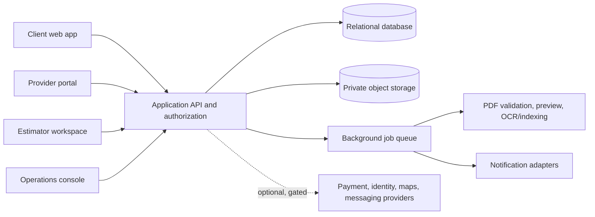

# Construction Planning and Marketplace Platform

## Technical Product and Design Specification

**Audience:** Product, product design, UX research, engineering, data, QA, marketplace operations, professional reviewers  
**Status:** MVP implementation baseline; unresolved decisions are marked explicitly  
**Prepared:** 12 November 2026  
**Related strategy:** [Evidence-backed product strategy and MVP specification](construction-platform-product-strategy.md)

---

## 1. Purpose and product direction

This document turns the product strategy into a shared implementation brief for the app-building, UI/UX and product-design teams. It defines the first product slice, core workflows, system responsibilities, UX rules, domain model, API boundaries, operational controls and acceptance criteria.

### Product promise

Help a customer move from a building brief or professionally prepared plans to a **traceable estimate, comparable local quotes and visible project actions**. The experience must communicate what is known, assumed, excluded, priced and professionally reviewed.

### Non-negotiable product constraints

1. An estimate from an arbitrary plan, image or text prompt is never presented as a construction-ready BoQ without validation by a qualified professional.
2. Each issued estimate and quote comparison is bound to a project, drawing revision, scope version, price basis, location and date.
3. Suppliers and contractors see only the information needed for a request or awarded package.
4. Provider verification has explicit levels and dates. “Verified” must never imply guaranteed workmanship, safety or solvency.
5. The product can launch in one location without baking that location’s currency, units, professional rules, permit process, taxes or payment rules into core logic.
6. The first release must work with manual operations and manual professional review. Automation assists a process; it does not become a hidden approval authority.

### Decisions not yet made

- Country, metro area, currency and operational radius.
- First building archetype and project size limits.
- Primary first payer and estimate-review operating model.
- Supported languages, local units, catalog/rate source and applicable professional measurement method.
- Whether any payments will be processed in the MVP. Default: no platform custody of project funds.

Keep these as configuration and launch gates. Do not hard-code Nigeria-specific regulations or rates until a launch geography is formally selected.

---

## 2. MVP definition

### First supported job

A client creates one low-rise building project in a single launch service area. They either need an **indicative budget range** or have plans for a **professionally reviewed estimate**. From the resulting scope they can request supplier and trade quotes, compare responses, record awards and track early delivery/work milestones.

The initial archetype should be chosen after discovery. The default research hypothesis is a simple, low-rise residential project. Complex commercial, high-rise, industrial, major renovation and design-build work are out of scope until separate workflows exist.

### MVP capabilities

- Account creation and role-based project collaboration.
- Guided brief and project/site intake.
- Private PDF/document upload, revision register and missing-information checklist.
- Indicative estimate range from explicit user inputs and configured benchmark data.
- Manual/assisted takeoff capture and qualified reviewer workflow for plan-based estimates.
- Estimate versions, line-item scope, assumptions, inclusions, exclusions and dated price basis.
- RFQs for selected material packages and trade scopes.
- Provider discovery from a curated, operations-approved pool.
- Comparable quote presentation and award record.
- Basic milestones, delivery evidence, variations and issue reporting.
- Admin console for provider review, estimate assignments, RFQs, incidents and audit history.

### Deferred capabilities

- Unreviewed AI-generated construction-ready quantities or design advice.
- Structural engineering, architecture, MEP design, soil interpretation or code sign-off.
- Guaranteed fixed price, platform-backed workmanship warranty, escrow or credit.
- Broad national provider marketplace or all building types/trades.
- Automated schedule generation, BIM authoring and permit filing.
- Shared model training on user drawings without an explicit consent and legal basis.

---

## 3. Roles, access and responsibilities

| Role | Main responsibilities | Default access |
|---|---|---|
| Project owner/client | Create brief, provide documents, review estimates, request quotes, award work, approve variations and milestones | All project data; controls invitations and sharing |
| Client collaborator | Help manage a project | Project data explicitly granted by owner; role can be view/comment/manage |
| Estimator/QS reviewer | Check document completeness, measure/validate quantities, set assumptions, price and issue review decision | Project documents and estimate; no unrelated personal/provider data |
| Supplier | Respond to material RFQs, clarify, fulfil awarded orders and report delivery issues | RFQ details and necessary delivery details; only after invitation/award |
| Trade contractor | Quote assigned work, clarify scope, update milestones and submit evidence/variations | Invited scope and necessary site data; private drawings masked unless needed |
| Marketplace operations | Verify profiles, facilitate RFQs, manage quality incidents and support | Operational access with reason logging and least privilege |
| Platform administrator | Manage configuration, access and system integrity | Privileged access; MFA; all high-risk actions audited |

### Permission rules

- Every project read/write is checked server-side against `ProjectRole`; hiding a button is not authorization.
- Provider matching can use location and project metadata without exposing the full address. Reveal exact address only when necessary and authorized.
- Documents have project-level permissions plus optional per-document restrictions. Credentials/identity files are segregated from public provider profile data.
- Reviewer identity and approval are recorded; estimates cannot be issued as “professionally reviewed” by a client or system account.
- Operations staff access to sensitive records requires a reason code and creates an audit event.

---

## 4. Core user journeys and screen map

### 4.1 Client: create project and choose estimate path

**Screens:** Welcome → Sign in/Create account → Project type → Site and location → Building brief → Design status → Upload documents (optional) → Review summary → Choose estimate path.

**Design behavior:**

- Ask for user-known information progressively; do not make the client answer professional questions they cannot reasonably know.
- Support “I’m not sure” and save-and-return.
- Explain difference between *indicative range* and *reviewed estimate* before asking for a selection.
- Show why address, area, floors, finish level and timing affect the range.
- Preserve form answers if upload or network request fails.

**Acceptance criteria:**

- User can create/save a project with partial inputs and see a clear list of missing fields.
- User can select an estimate path without implying the system can certify the design.
- Unit and currency labels follow project location settings, not device locale alone.
- Project creation works on a narrow mobile viewport and with keyboard-only navigation.

### 4.2 Client: upload and manage plans

**Screens:** Project → Documents → Upload → Processing status → Drawing register → Document detail/preview → Missing information.

**Design behavior:**

- Accept supported file types and show size/page constraints before upload.
- Show upload, scan, preview and indexing states separately; processing failure must retain the original file and offer retry/manual route.
- Capture document category, author (optional), date, drawing number, revision and related discipline where known.
- Never silently replace a prior plan. New upload creates a new revision or document record and asks whether it supersedes an earlier version.
- Allow marking a document as draft, issued for review or approved for construction only when the uploader has a basis; explain that the label is user-supplied.
- Show who can access each file. Support removal requests and retention policy.

**Acceptance criteria:**

- Every takeoff reference points to immutable document ID and revision.
- Unsupported/corrupt/encrypted PDF gets an actionable message and a support/manual path.
- A user can preview the stored file and inspect its revision metadata before requesting an estimate.
- Upload progress and retry do not create duplicate project files unintentionally.

### 4.3 Client: indicative estimate

**Screens:** Project brief → Assumptions → Estimate range → Cost drivers → Next steps.

**Estimate card fields:** low/high range, currency, included work sections, data location, benchmark date, quality band, contingency treatment, exclusions, completion status and CTA to request professional review.

**Acceptance criteria:**

- The word “indicative” appears in the estimate title and downloadable view.
- No quantities are labeled as measured from plans unless they actually are.
- A missing/unsupported location or archetype returns “not enough local data” instead of fabricating a range.
- User can inspect assumptions and change inputs to recalculate; previous value is not confused with current.

### 4.4 Estimator: review and issue a plan-based estimate

**Screens:** Reviewer queue → Project/document register → Review checklist → Drawing viewer/takeoff → Estimate worksheet → Quality checks → Submit review → Issue confirmation.

**Review checklist:**

- Confirm project location and archetype.
- Confirm drawings are legible, units and scale have been checked, revisions are consistent.
- Identify missing structural, MEP, site or specification information.
- Mark scope as measurable, provisional, excluded or clarification required.
- Record takeoff formula/source and rate source/date/location for each applicable line.
- Check total arithmetic, unit conversions, inclusions/exclusions, contingency and estimate validity.
- Confirm reviewer role/qualification appropriate to represented review.

**Workspace behavior:**

- Drawing viewer supports page navigation, zoom, pan, page rotation where safe, scale calibration, measurement markup, undo and note pins.
- Takeoff entries show source sheet and revision, measurement type, geometry, unit, formula, quantity, adjustment, author and review state.
- Provide separate layers for architecture, structural, MEP and site work.
- Warn if an estimate line has no source, has an obsolete revision, or depends on an unconfirmed assumption.
- Draft autosave and explicit submit/issue action; issue action shows a preview of what the customer will see.
- Rejected/unreviewed lines cannot appear as reviewed quantity without a visible status.

**Acceptance criteria:**

- A reviewer can return “information required” with questions tied to exact drawing/scope lines.
- All issued estimates have version number, reviewer, issue timestamp, location, currency, validity and basis.
- Material/design changes after issue produce a new version and a visible line-by-line change summary.
- No page-only AI suggestion is persisted as measured work until the reviewer confirms it.

### 4.5 Client: compare and award supplier quotes

**Screens:** Estimate → Select package → RFQ details → Provider selection/assisted matching → RFQ sent → Quote comparison → Clarification → Award.

**Quote comparison columns:** provider, exact specification/brand, quoted quantity/unit, unit price, delivery, taxes/fees, total delivered price, availability, delivery date, substitution, payment terms, quote expiry and verification details.

**Design behavior:**

- Normalize comparable totals while retaining original supplier wording and terms.
- Flag different specifications, missing delivery, quantity changes and expired quotes; do not rank incomparable offers as cheapest.
- Explain whether provider was matched by operations, selected by user or sponsored.
- Before award, confirm scope, terms, delivery location, date and known exclusions.
- Where no provider responds, offer revise, widen service area or ask operations for help; avoid false “no providers available” if manual sourcing is possible.

**Acceptance criteria:**

- Quote can be saved as draft and revised by supplier until submission/deadline rules close it.
- Each comparison is tied to one RFQ version and stored quote snapshots.
- Award record contains winner, accepted quote version, reason (optional), exact terms and confirmation by authorized client.
- Expired or withdrawn offers remain in history, visibly labeled.

### 4.6 Client and provider: coordinate delivery/trade package

**Screens:** Project overview → Schedule/milestones → Package detail → Update status → Upload evidence → Variation request → Completion/issue resolution.

**MVP statuses:** Not started → Ready → In progress → Awaiting client → Blocked → Complete → Disputed/cancelled.

**Acceptance criteria:**

- Status change has actor, timestamp and optional note/evidence.
- A variation captures reason, affected scope/estimate lines, proposed cost and time effect, documents/evidence, provider and approval state.
- Provider cannot mark owner approval on behalf of the client.
- Delivery acceptance and quality complaint are separate actions; accepting receipt does not imply technical quality approval.
- A user can report a safety concern and is told how to contact local emergency services/authorities when appropriate.

### 4.7 Operations: provider onboarding and incident handling

**Screens:** Provider queue → Profile and evidence → Verification checklist → Decision → Re-check calendar → Incident queue → Evidence timeline → Resolution.

**Acceptance criteria:**

- Each verification item has status, source, checked date, checker and expiry/re-check date.
- Decline/suspension reason is recorded and visible according to policy.
- Sensitive document access is logged; profile publishes only user-approved fields.
- Incident resolution includes communication timeline, evidence, decision, appeal status and refund/financial actions if enabled.

---

## 5. Estimation state, labels and content rules

### Estimate status lifecycle

```text
Draft
  ├─> Information required ─> Draft
  └─> Submitted for review ─> Under review
                              ├─> Information required ─> Draft
                              ├─> Changes requested ────> Draft
                              └─> Professionally reviewed ─> Issued
Issued ─> Accepted by client ─> Superseded by a new version
Issued ─> Expired (rates/validity) ─> Reprice or new version
```

### Required customer-facing labels

| Label | Meaning | Required UI copy/data |
|---|---|---|
| Indicative range | Broad planning signal using typology and benchmark data | “Not a BoQ or supplier quote”; assumptions, location/date, range and exclusions |
| Draft takeoff | Measurements or extracted values not fully reviewed | “Requires review”; per-line confidence/status; no procurement CTA from draft lines |
| Professionally reviewed | Named qualified reviewer checked the stated scope and basis | Reviewer name/role, review date, design revision, scope limits, validity and exclusions |
| Supplier-confirmed quote | Provider confirmed a price and terms | Provider, quote time/expiry, stock, spec, delivery and terms |
| Platform verification | Specific checks completed by platform | Exact checks and date; explicit statement that this is not a performance guarantee |

### Estimation source-of-truth rules

- Quantity and rate are separate fields. A price update must not rewrite a measured quantity or issued estimate.
- Preserve measurement derivation and any manual adjustment/waste allowance separately.
- For each cost line store `source_type`, `source_reference`, `observed_at`, `location_id`, `currency`, `unit`, `specification`, `valid_until` and `confidence/status` as applicable.
- All totals use decimal-safe currency arithmetic; no binary floating-point for money.
- If a conversion is used, persist source unit, target unit, conversion factor, rule version and reviewer confirmation when conversion is ambiguous.
- “Confidence” may describe data completeness or extraction certainty; it must not be presented as probability the project will finish at that price unless calibrated evidence supports it.

---

## 6. Technical architecture and boundaries

### Recommended MVP shape

Use a modular application with clear domain boundaries; keep it deployable as one service until scale justifies service separation.



### Module boundaries

1. **Identity and access:** users, organizations, roles, sessions, MFA for staff, invitations and consent.
2. **Projects and documents:** project/site metadata, drawing register, file access, revisions and retention.
3. **Estimation:** estimate versions, work sections, items, takeoff measurements, assumptions, reviews and rate basis.
4. **Catalog and pricing:** item taxonomy, units/conversions, rate observations, location rules and expiration.
5. **Marketplace:** provider profiles, checks, availability, matching, RFQs, quote offers and awards.
6. **Execution records:** purchase/order records, deliveries, trade packages, milestones, variations and evidence.
7. **Trust and support:** reviews, reports, disputes, safety incidents, refunds (if later enabled) and audit events.
8. **Notifications:** user preferences, delivery channel adapters, templates and delivery receipts.
9. **Administration/configuration:** launch region, currencies, units, legal copy, review thresholds, document constraints and feature flags.

### Background jobs

- Malware scan and file type validation.
- PDF page count/render/thumbnail and text extraction.
- Optional drawing-page classification or OCR suggestions (never authoritatitive without review).
- Stale quote/rate reminders and estimate expiry notices.
- Provider verification expiry reminders.
- Notification delivery and retry with idempotency key.
- Periodic export/backup integrity checks and retention/deletion jobs.

### Storage and security requirements

- Private object storage with encryption at rest and in transit; short-lived access URLs; no public bucket for drawings, credentials or site evidence.
- File scanning before reviewer/provider access; record file hash, uploader, timestamp and detected type.
- Enforce request size/page limits and rate limits; defend against malicious PDFs and image decompression attacks.
- Separate personally identifying and provider credential data from estimate content where feasible.
- Audit issue, approval, award, permission, export, deletion and operations-access events.
- Encrypted backups, tested restoration procedure, documented RPO/RTO target before launch.
- Data minimization, deletion and retention schedules depend on selected jurisdiction and professional/contract obligations.

---

## 7. Domain model

### Main entities

| Entity | Important fields / rules |
|---|---|
| `User` | `id`, contact identifiers, locale, verification state, created/disabled timestamps; do not expose identity fields to providers by default |
| `Organization` | `id`, legal/display name, type, service areas, business status |
| `Project` | `id`, owner organization/user, project type, location reference, status, currency, units system, privacy level |
| `ProjectRole` | project, user/org, role, granted by, expiry, scopes |
| `Site` | coarse location for matching; exact address encrypted/restricted; site constraints and access instructions have separate permissions |
| `Document` | immutable file blob/version metadata, category, revision, discipline, issue date, author, checksum, access policy |
| `EstimateVersion` | project, sequence, status, design snapshot, currency, issue/expiry, reviewer, total range/amount, review basis |
| `EstimateLine` | section, description, unit, quantity, rate, amount, spec, inclusion state, source and confidence/status |
| `TakeoffMeasurement` | estimate line, document/revision/page, measurement type/geometry, scale, formula, result, author, reviewer, adjustment |
| `Assumption` | estimate version/line, statement, category, owner, resolved state and resolution evidence |
| `RateObservation` | catalog item/spec/location/unit, price components, source/provider, observed time, valid-until, verification state |
| `Provider` | organization/user, categories, service area, public profile, verification tier, availability, moderation state |
| `CredentialCheck` | provider, credential type, issuer/source, reference, result, checked-by/on, expiry, access-controlled evidence |
| `RFQ` | project, scope version, package, location granularity, requested date, deadline, status and invited provider set |
| `Quote` / `QuoteLine` | provider, RFQ version, spec, quantity/unit, price, delivery/tax/fees, substitution, availability, expiry and terms |
| `Award` | RFQ, accepted quote snapshot, authorized client, award timestamp, contract/order link |
| `Delivery` | order/quote, expected and actual quantity, item condition, date, recipient, evidence and discrepancy |
| `TradePackage` | scope reference, provider, contract terms reference, status, start/end expectations |
| `Milestone` | package, sequence, owner, dependency, date, status, completion evidence |
| `Variation` | package/estimate lines, reason, cost/time impact, proposal, approvals and version |
| `Issue` / `Dispute` | category, severity, parties, evidence timeline, status, resolution, appeal and restricted notes |
| `AuditEvent` | actor, action, target, project, time, reason, safe metadata; append-only |

### Versioning invariant

An issued estimate, RFQ, quote and award are immutable snapshots. Corrections create a new version linked to the prior one. Any current-view shortcut must still expose the version it represents. Avoid a mutable “latest price” field on historical issued records.

---

## 8. API contract outline

API style can be REST or typed RPC, but these domain guarantees apply. Use stable IDs, explicit pagination, idempotency for create/award/payment actions, structured errors and optimistic concurrency via version/ETag.

### Example endpoint groups

```text
POST   /v1/projects
GET    /v1/projects/{projectId}
PATCH  /v1/projects/{projectId}
POST   /v1/projects/{projectId}/members

POST   /v1/projects/{projectId}/documents/upload-intents
POST   /v1/projects/{projectId}/documents/{documentId}/complete
POST   /v1/projects/{projectId}/documents/{documentId}/revisions
GET    /v1/projects/{projectId}/documents

POST   /v1/projects/{projectId}/estimate-requests
GET    /v1/projects/{projectId}/estimates
POST   /v1/projects/{projectId}/estimates/{estimateId}/submit-review
POST   /v1/projects/{projectId}/estimates/{estimateId}/review-decisions
POST   /v1/projects/{projectId}/estimates/{estimateId}/issue

POST   /v1/projects/{projectId}/rfqs
POST   /v1/rfqs/{rfqId}/invitations
POST   /v1/rfqs/{rfqId}/quotes
POST   /v1/rfqs/{rfqId}/award

POST   /v1/projects/{projectId}/packages
POST   /v1/packages/{packageId}/milestones
POST   /v1/packages/{packageId}/variations
POST   /v1/variations/{variationId}/decisions
POST   /v1/projects/{projectId}/issues
```

### Example estimate line response

```json
{
  "id": "line_123",
  "estimateVersionId": "estv_004",
  "section": "Substructure",
  "description": "Excavation for foundation",
  "specification": null,
  "quantity": { "value": "64.00", "unit": "m3", "status": "reviewed" },
  "quantitySource": {
    "type": "takeoff",
    "documentId": "doc_17",
    "revisionId": "rev_3",
    "page": 2,
    "measurementId": "measure_912"
  },
  "rate": {
    "value": "8500.00",
    "currency": "NGN",
    "basis": "reviewed_supplier_observation",
    "observedAt": "2026-11-01T10:00:00Z",
    "locationId": "location_configured_at_launch"
  },
  "inclusion": "included",
  "reviewStatus": "reviewed",
  "amount": { "value": "544000.00", "currency": "NGN" }
}
```

Example values illustrate the schema only; do not treat them as current prices or a recommended construction quantity.

### API error states

- `400` invalid field/unit/transition; include field-level errors.
- `401/403` unauthenticated/not authorized; do not leak whether a private project exists.
- `404` unavailable or not visible to caller.
- `409` stale version/concurrent update; return current version identifier and safe refresh guidance.
- `413` file or request too large; state allowed limit.
- `422` unresolved precondition, such as missing drawings/required reviewer or expired quote.
- `429` request throttled with retry guidance.
- `5xx` generic correlation ID; no sensitive stack traces.

### Example state transition request

```json
{
  "decision": "request_information",
  "expectedVersion": 7,
  "questions": [
    {
      "lineId": "line_123",
      "documentId": "doc_17",
      "revisionId": "rev_3",
      "page": 2,
      "message": "Please confirm the foundation depth; it is not specified in this sheet."
    }
  ]
}
```

Transitions must be validated against role and current state; do not accept arbitrary client-provided `status` values.

---

## 9. UI/UX and design system requirements

### Information architecture

**Client navigation:** Home/projects · Estimates · Quotes & orders · Providers · Messages · Account.  
**Provider navigation:** Leads/RFQs · Quotes · Active orders/jobs · Availability/profile.  
**Reviewer navigation:** Review queue · Projects · Rate observations · Templates.  
**Operations navigation:** Work queue · Providers · RFQs · Estimates · Incidents · Configuration.

On small screens, prioritize project status, next action, cost summary and outstanding decisions. Deep tables may scroll horizontally only when a responsive stacked/card alternative cannot preserve comparison clarity.

### Visual hierarchy and language

- Use plain, nontechnical labels with a “Learn what this means” explainer for BoQ, takeoff, contingency, unit rates and revision.
- Make the next action explicit on project overview; surface blockers before secondary information.
- Distinguish estimate, supplier quote and actual cost using both label and visual style; never rely on color alone.
- Show price date, location and expiry adjacent to totals, not buried in terms.
- Display confidence/review status on the line item and total summary where it changes interpretation.
- Use progressive disclosure for detailed QS formulas while keeping assumptions and exclusions accessible to clients.
- Avoid persuasive urgency timers unless tied to a real quote expiry.

### Responsive and field use

- Mobile-first customer and provider workflows for upload, quote response, delivery photo and milestone update.
- Preserve drafts offline or during interrupted connections where feasible; queue photo uploads and clearly show pending sync.
- Avoid requiring long free-text messages for routine updates; offer structured reason choices plus optional notes.
- Large tap targets, camera upload, low-bandwidth image compression and readable tables on small screens.

### Accessibility baseline

- Target WCAG 2.2 AA for supported web journeys.
- Semantic headings, labels, form descriptions, error summary and programmatic state announcements.
- Full keyboard support for modal, drawing viewer controls, menus, tables and status changes.
- Focus management after route changes, dialogs, validation errors and document upload.
- Minimum contrast, visible focus, reduced motion option and no color-only status communication.
- Provide accessible non-canvas representation of drawing measurements and their numeric values; canvas interaction must have keyboard alternatives.
- Caption/transcript training media; provide text alternatives for evidence and generated charts.

### Content and error writing

- Say what happened, what is affected and what to do next.
- For estimate uncertainty: “We need the structural drawings before we can review the foundation quantities.”
- For stale pricing: “This supplier price expired on [date]. Request an updated quote before using this total.”
- For unsupported plan extraction: “We couldn’t reliably read this drawing. The file is saved; a reviewer can continue manually.”
- Avoid “accurate,” “guaranteed,” “certified,” “safe” and “construction-ready” unless the product has defined evidence and a qualified accountable party behind the claim.

---

## 10. Functional requirements and acceptance checklist

### Project intake

- Required: project label, building use, location at launch-approved granularity, project owner, estimate path.
- Optional/conditional: site status, dimensions/area, floors, finish band, timeline, budget band, special constraints.
- User can save incomplete intake and resume later.
- Data validation is location/config-aware and explains units.

### Documents

- Private upload, revision history, permissions, preview, processing state, metadata and deletion request.
- Takeoffs always refer to explicit document revision and page.
- AI/OCR outputs are suggestions with provenance and user/reviewer confirmation state.

### Estimates

- Line-level quantity, unit, rate, amount, specification, source and inclusion status.
- Assumptions/exclusions visible in customer export.
- Reviewer sign-off and estimate version required before “professionally reviewed” label.
- Change summary compares old/new quantities, rates, scope and total.
- Expired estimate cannot be used for new RFQ without a warning/reprice path.

### RFQs and provider marketplace

- Each RFQ includes clear scope, unit/spec, quantities, location/delivery needs, date, response deadline and terms requested.
- Provider accepts/declines invitation and may ask a question.
- Quote supports line details, substitution, availability, delivery, fees/tax, expiry and attachments.
- Client receives a structured quote comparison and can award, reject or request clarification.
- No unearned verification badge; profile distinguishes each check.

### Project coordination

- Milestones and delivery evidence are timestamped and attributed.
- Variations have explicit status and client approval; project scope/budget is not silently modified.
- Disputes and safety incidents have separate severity/status workflows and restricted notes.

### Operations

- Review queues are filterable by overdue, risk and project status.
- Operations can see source and history but cannot rewrite a customer-issued estimate without a new version.
- Every sensitive operation is auditable; reviewer/provider checks have due dates.

---

## 11. Non-functional requirements

| Area | MVP requirement |
|---|---|
| Reliability | Define service availability and recovery targets before pilot; failed async processing must not lose the upload or block manual continuation |
| Performance | Common project screens should remain usable on mobile networks; paginate large estimates/quote histories; lazy-load plan previews |
| Security | Server-side authorization, MFA for privileged staff, secure upload processing, secrets management, audit logs and routine dependency/security review |
| Privacy | Minimize personal and site data; consent and purpose records; retention/deletion workflow; access logging for plans and ID files |
| Data integrity | Decimal money, unit conversion provenance, immutable issued snapshots, idempotent award/issue actions and optimistic concurrency |
| Accessibility | WCAG 2.2 AA target, keyboard journeys and accessible drawing-data alternative |
| Localization | Externalized copy, configurable currency/locale/time zone, units, tax labels and number formats; store canonical values plus display preferences |
| Observability | Correlation IDs, actionable errors, background-job status, alerting for upload/notification failures and abuse patterns |
| Portability | Export project estimate/quote/record set in usable formats; no lock-in to proprietary takeoff shapes without export path |
| Compliance readiness | Jurisdiction configuration and legal review gates for construction, professional conduct, privacy, payments, marketing and consumer protection |

---

## 12. Safety, privacy and operational controls

### Safety boundaries

- The app does not design or approve structural systems, electrical systems, fire protection, drainage or code compliance.
- If an estimate lacks necessary engineering/specification input, the reviewer marks affected scope provisional/excluded and asks for documents.
- A safety incident bypasses ordinary customer support queue and follows a documented escalation protocol.
- Marketing and interface copy distinguish platform moderation from professional certification.

### Privacy controls

- Plans can expose home layout, security details and personal addresses. Default visibility is private to the project.
- Collect identity/credential data only for defined checks; expose result and expiry, not source document, on public profile.
- Define data retention by category: plans, estimate snapshots, identity evidence, dispute records and analytics may need different schedules.
- Obtain clear permission before using private documents for machine learning or product improvement beyond service delivery.
- Create data export, correction, deletion and incident-notification procedures for the eventual launch jurisdiction.

### Dispute taxonomy

1. Estimate/scope dispute.
2. Material specification/substitution/quality dispute.
3. Delivery quantity, condition or lateness dispute.
4. Workmanship/defect dispute.
5. Payment/refund issue (only if payments are enabled).
6. Credential/fraud concern.
7. Safety incident.

Each category has evidence guidance, response timeline, ownership, escalation and closure reason. Do not let ratings substitute for resolution.

---

## 13. Analytics and event instrumentation

Instrument events with pseudonymous actor/project IDs and avoid sending plans, exact addresses, message bodies or identity data to analytics.

```text
project_created
project_intake_saved
estimate_path_selected
document_upload_started / completed / failed
document_revision_added
estimate_request_submitted
review_information_requested
takeoff_line_created / confirmed / changed
estimate_issued / accepted / expired / superseded
rfq_created / sent / response_received / awarded / expired
quote_clarification_requested
provider_check_completed / expired / failed
delivery_confirmed / discrepancy_reported
milestone_started / completed / blocked
variation_submitted / approved / rejected
issue_opened / resolved / appealed
```

Every event definition must state owner, trigger, permitted properties, PII exclusions and how it supports a product decision. Do not use “estimate generated” as a quality measure; capture review effort, variance and actual procurement outcomes.

---

## 14. Delivery plan and team handoffs

### Discovery and service blueprint

**Product:** select candidate segment and define measurable problem.  
**Design/research:** observe intake, QS review, supplier quoting and delivery workflows.  
**Engineering/data:** test file/document constraints, system boundary and rate data model.  
**Operations/professionals:** define review standard, provider checks, dispute and safety workflows.  
**Exit gate:** one launch metro, project archetype, operational owner, estimate reviewer supply and validated payment stance.

### MVP build sequence

1. Roles, project intake, secure files and document revisions.
2. Estimate worksheet, review queue, versioning and customer report.
3. Provider onboarding, RFQ, quote response and comparison.
4. Award, simple milestones, delivery evidence and variations.
5. Admin operations, audit, incident workflows, analytics and export.
6. Pilot with real projects, measure review/ops costs and fix unsafe ambiguity before expansion.

### Team handoff artifacts

- Product: prioritized backlog, decision log, launch geography configuration and metric definitions.
- Design: clickable flows for client/provider/reviewer/admin, responsive states, empty/error/loading/permission/low-data states, content spec and accessibility annotations.
- Engineering: domain model, API schema, authorization matrix, data retention map, threat model, migration plan and integration inventory.
- Estimation operations: standard review checklist, acceptable source material, pricing update procedure, sign-off criteria and escalation map.
- QA: role/state matrix, estimation-version cases, unit/conversion cases, access control cases, stale quote cases and offline/interrupted upload cases.

---

## 15. Quality gates and release criteria

### Before closed pilot

- Launch geography, currency, units and legal/professional boundaries are approved.
- At least one qualified reviewer is available and accountable for the review process.
- Provider checks, user-facing verification wording and incident escalation are defined.
- Private file access, audit events, backup/recovery and data deletion procedures are operational.
- Estimate labels distinguish indicative, draft, reviewed and supplier-confirmed outputs.
- RFQ and quote comparison handles different units/specifications without misleading ranking.

### Before public launch

- Pilot demonstrates the estimate can be reviewed at sustainable cost and price data is fresh enough for the represented use.
- Common local material and trade categories have credible provider coverage and response handling.
- User testing shows clients understand exclusions, quote expiry and estimate maturity.
- Security and privacy review completed for selected jurisdiction and payment model.
- Accessibility review covers all primary journeys, including drawing review controls.
- Dispute, cancellation, support and safety response teams have documented coverage and service targets.

### High-risk release blockers

- Unreviewed generated quantities appear as approved/procurement-ready.
- A provider can access a project or plan without a valid invitation/award permission.
- Estimate/quote version changes after issue without a new version and audit trail.
- Currency/unit mismatch can produce a plausible but incorrect comparison.
- User cannot tell if a price is stale, indicative, excluded or not supplier-confirmed.
- Platform holds funds without approved legal, payments and safeguarding design.

---

## 16. Open questions for product/design kickoff

1. Which country and one metro area will be first? What evidence supports that choice?
2. Which single building type and complexity ceiling can local reviewers estimate repeatably?
3. Who pays first: client estimate/review fee, professional SaaS, provider lead fee, or another model?
4. Which professionals can issue the reviewed estimate, under which qualifications and liability terms?
5. What source will provide fresh local price observations and how often must each category be refreshed?
6. Which three trade/material packages have enough local supply to create useful quote comparison?
7. What exactly is checked for each provider verification level?
8. Will payments be recorded only, handled by a regulated partner, or omitted from the first release?
9. What retention rules apply to architectural drawings and provider identity evidence?
10. Which languages, accessibility needs and connectivity limitations matter in the launch area?

## Appendix A — Evidence basis

This implementation brief derives from the prior strategy document and current public descriptions of estimating and marketplace workflows. Useful references include [Procore estimating](https://www.procore.com/estimating), [Buildxact takeoff workflow](https://help.buildxact.com/en/articles/9266681-using-the-buildxact-takeoff-tool), [Houzz Pro takeoff guide](https://pro.houzz.co.uk/pro-help/r/how-to-use-takeoffs-on-houzz-pro), and Nigerian marketplace/estimation examples [BMM](https://bmm.ng/), [PAPAPA NOW](https://papapanow.com/), [Buildam](https://buildam.io/) and [BuildNovi](https://buildnovi.com/). Their public descriptions inform interface and workflow expectations but do not independently prove quality, adoption or operations. Professional, privacy, construction and payments rules must be confirmed for the selected market before launch.
